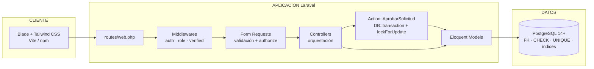
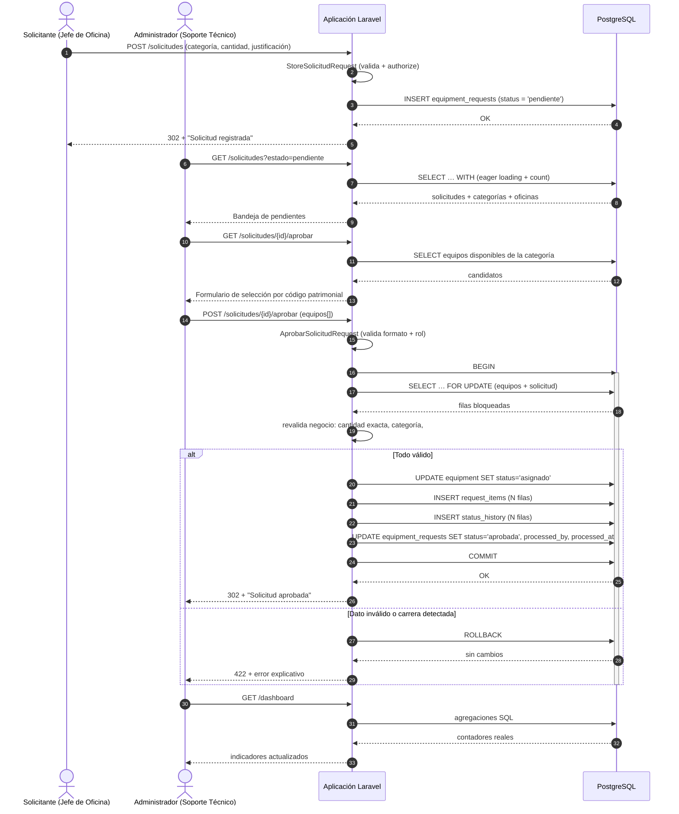
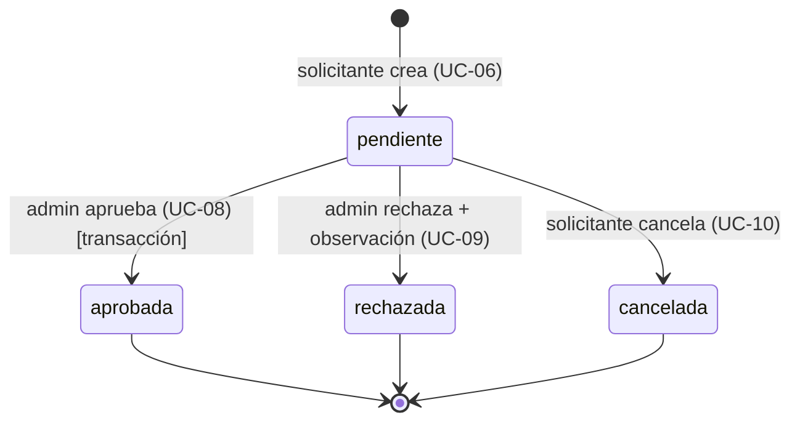
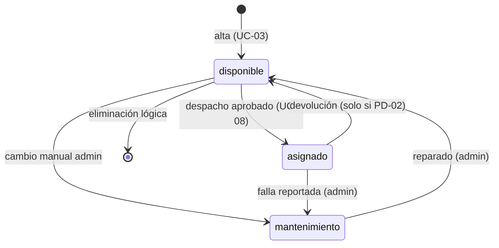
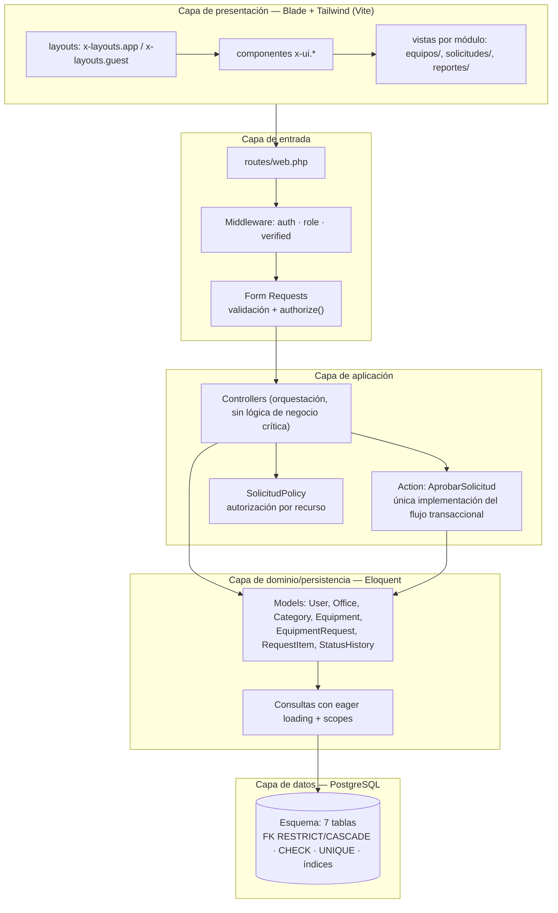
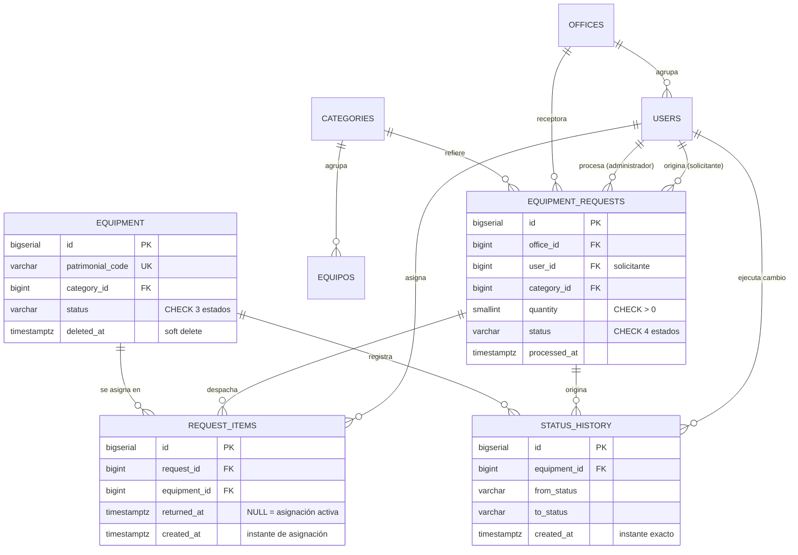
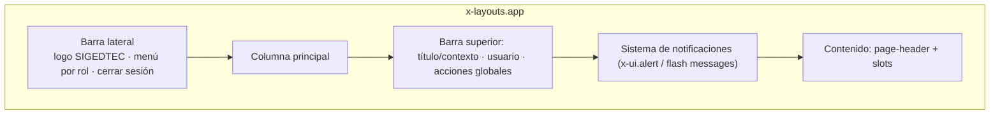
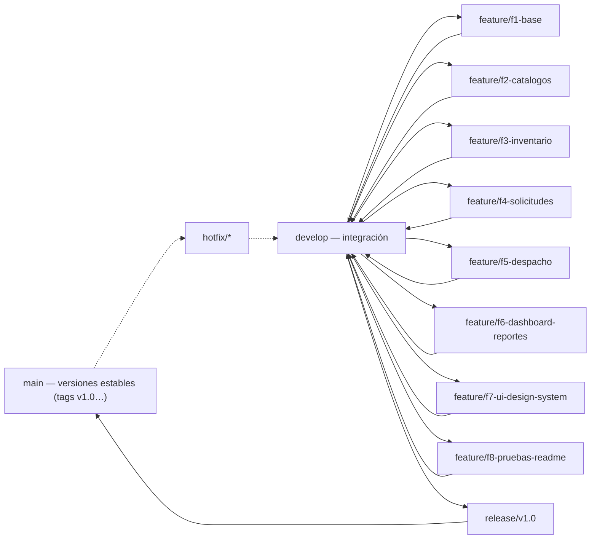

# SDD — SIGEDTEC

## Sistema de Gestión de Inventario y Despacho Tecnológico

**Documento de Diseño de Software (Software Design Document)**
Contrato de diseño del proyecto — fuente principal de verdad para arquitectura, implementación y pruebas.

---

## 1. Portada y control de versiones

| Campo | Valor |
| --- | --- |
| Nombre del sistema | SIGEDTEC — Sistema de Gestión de Inventario y Despacho Tecnológico |
| Versión del documento | 2.1 |
| Estado | **En revisión — pendiente de aprobación por el equipo/usuario** |
| Autor | Arquitectura de software — Trayecto III, PNF en Informática |
| Institución | Universidad Politécnica Territorial |
| Contexto | Mini Proyecto — curso de Trayecto III (nivel intermedio) |
| Stack principal | Laravel 11 (o 10) · PHP 8.2+ · PostgreSQL 14+ · Blade + Tailwind CSS · Breeze · PHPUnit |
| Método de control de versiones | GitFlow (`main`, `develop`, `feature/*`) |
| Fecha | Octubre 2026 |

### 1.1 Historial de versiones

| Versión | Fecha | Cambios |
| --- | --- | --- |
| 1.0 | Oct 2026 | Borrador inicial basado literalmente en el enunciado académico (7 tablas, 4 módulos). |
| 2.0 | Oct 2026 | Rediseño completo según Prompt Maestro: se añaden glosario, RF/RNF, matriz de permisos, casos de uso, flujos con diagramas, diccionario de datos, estrategia de pruebas, plan de fases, despliegue, riesgos y **Design System v1.0**; se incorporan oficinas como catálogo, bitácora `status_history`, bloqueo pesimista, política de registro de usuarios y decisiones pendientes. |
| 2.1 | Oct 2026 | Fase 1 ejecutada en `C:\xampp\htdocs\proyecto yoceliana\sigedtec`. Se ajusta D‑01/PD‑08: se adopta **Laravel 12.70** porque Composer bloquea todas las versiones 11.x por avisos de seguridad. Entorno real: PHP 8.4.22, PostgreSQL 18 (puerto **5433**, auth `trust`), Node 24, Breeze 2.4 + Tailwind + Vite 7. Base: 7 tablas migradas, `migrate:fresh --seed` coherente y suite PHPUnit en verde (31 pruebas / 77 aserciones) contra `sigedtec_test`. |

### 1.2 Cómo usar este documento

1. Toda implementación debe poder trazarse a una sección del SDD (§27 contiene la matriz).
2. Las decisiones marcadas **[Recomendada]** son propuestas por el autor y deben confirmarse antes de programar (lista en §28).
3. Las decisiones marcadas **[Requiere aprobación]** no deben implementarse sin un "sí" explícito.
4. Cambiar una decisión implica actualizar este documento **antes** de cambiar el código.

---

## 2. Resumen ejecutivo

El departamento de soporte técnico de una institución pública gestiona sus bienes informáticos de forma manual: no hay trazabilidad de quién recibe qué equipo, ni cuándo cambió su estado, y las solicitudes se pierden en procesos informales. SIGEDTEC es una **aplicación web monolítica modular** (Laravel + PostgreSQL) que centraliza el inventario, estructura el flujo *solicitud → aprobación → despacho* y deja un rastro auditable de cada movimiento.

Los puntos clave del diseño:

- **Dos roles fijos** (`admin` de Soporte Técnico y `solicitante` Jefe de Oficina) con autorización aplicada en servidor: middleware de ruta + `authorize()` en Form Requests + verificación de propiedad en cada consulta.
- **Inventario con soft deletes**, código patrimonial único y catálogo de categorías en relación 1:N.
- **Proceso central transaccional**: la aprobación selecciona equipos concretos por código patrimonial dentro de `DB::transaction()` con `lockForUpdate()`, de modo que es imposible quedar a medias o asignar el mismo equipo dos veces.
- **Trazabilidad por diseño**: el estado actual del equipo nunca es la única memoria; cada cambio genera una fila en `status_history` con instantes `timestamptz`, y cada asignación queda en `request_items` de forma permanente.
- **Datos reales en el dashboard**: los indicadores provienen de agregaciones SQL, nunca de valores codificados.
- **Design System v1.0**: layout único (barra lateral + topbar + contenido + notificaciones), componentes Blade `x-ui.*` reutilizables y tokens de color/espaciado centralizados, para que la interfaz evolucione sin rehacer pantallas.



---

## 3. Propósito y objetivos del sistema

### 3.1 Propósito

Sustituir el proceso manual de control de bienes informáticos por un sistema web que garantice **persistencia, integridad de los datos, trazabilidad total y una experiencia de usuario fluida**, demostrando buenas prácticas de ingeniería de software a nivel intermedio.

### 3.2 Objetivos generales

1. Automatizar el ciclo de vida de los equipos tecnológicos: registro → disponibilidad → asignación → seguimiento.
2. Estructurar la comunicación entre Jefes de Oficina y Soporte Técnico mediante un flujo formal de solicitudes.
3. Garantizar que ningún dato quede en un estado inconsistente (integridad + atomicidad).
4. Ofrecer indicadores y reportes confiables para la toma de decisiones.

### 3.3 Objetivos específicos (medibles)

| # | Objetivo | Cómo se verifica |
| --- | --- | --- |
| OBJ‑01 | Registrar equipos con código patrimonial único e inventario consultable con filtros | CA‑03 (§27) |
| OBJ‑02 | Eliminar el registro manual reemplazándolo por el flujo solicitud→despacho | Flujo completo en §11 |
| OBJ‑03 | Registrar fecha y hora exacta de **cada** cambio de estado | Filas en `status_history` — CA‑07 |
| OBJ‑04 | Cero asignaciones parciales o duplicadas ante fallos o concurrencia | Pruebas de transacción — CA‑05, CA‑06 |
| OBJ‑05 | Dashboard con cifras derivadas de PostgreSQL en tiempo real | CA‑08 |
| OBJ‑06 | Interfaz uniforme y reutilizable (mismo layout y componentes en todas las pantallas) | Anexo A |

### 3.4 Objetivos no funcionales

Arquitectura mantenible (convenciones Laravel, sin capas superfluas), rendimiento sin consultas N+1, seguridad aplicada en servidor, accesibilidad WCAG 2.1 AA como referencia y una base visual uniforme que permita evolucionar el diseño sin reconstruir módulos.

---

## 4. Alcance y exclusiones

### 4.1 En alcance (obligatorio)

| Módulo | Contenido |
| --- | --- |
| M1 Autenticación y usuarios | Login/logout/registro, roles, oficina asociada, middleware de rol |
| M2 Oficinas | Catálogo institucional (código, nombre, ubicación, activo/inactivo) |
| M3 Categorías | CRUD + desactivación, relación 1:N con equipos |
| M4 Inventario | CRUD completo, soft deletes, filtros, estados, bitácora de movimientos |
| M5 Solicitudes | Crear, consultar propias, cancelar pendiente, ver observaciones |
| M6 Aprobación y despacho | Aprobar/rechazar con selección de equipos, transacción, bloqueo de filas |
| M7 Dashboard | Indicadores reales, solicitudes y movimientos recientes, distribución por categoría |
| M8 Reportes | Inventario, solicitudes por estado, historial de asignaciones por oficina, movimientos por período |
| Transversal | Design System, componentes Blade, Form Requests, seeders/factories, GitFlow, README, pruebas PHPUnit |

### 4.2 Fuera de alcance (no se construye en v1)

- API REST, SPA o frameworks JS de interfaz (Vue/React/Inertia) — sin justificación real para este nivel.
- Notificaciones por correo/SMS, mensajería en tiempo real.
- Exportación a PDF/Excel (adicional, ver §14‑M9 y PD‑06).
- Múltiples instituciones, sucursales o jerarquías de rol superiores a dos.
- Recuperación de contraseña por correo (se omite el enlace de Breeze; ver §14‑M1).
- Infraestructura de caché (Redis), colas o microservicios — la escala esperada (cientos de equipos, decenas de usuarios) no lo justifica.
- Multiidioma; la interfaz está íntegramente en español.

### 4.3 Alcance condicional (pendiente de aprobación — ver §28)

| ID | Funcionalidad | Recomendación |
| --- | --- | --- |
| PD‑02 | **Devoluciones de equipos** (M7 del prompt) | Incluir en una **Fase 6 opcional** (§25) con el diseño ya especificado en §14‑M7 |
| PD‑01 | Registro público de usuarios vs. creación solo por administrador | Recomendado: registro público con rol forzado en servidor |
| PD‑03 | Aprobación parcial de solicitudes | Recomendado: **no** en v1 (todo‑o‑nada) |
| PD‑06 | Exportación PDF/Excel | Recomendado: no en v1 |

---

## 5. Glosario

| Término | Definición |
| --- | --- |
| Bien patrimonial | Activo físico de la institución sujeto a inventario y control. |
| Código patrimonial | Identificador único e inmutable de un equipo dentro del inventario (ej. `SIG-2026-0017`). |
| Despacho | Acto formal de entregar equipos aprobados a una oficina; en el sistema = transacción de aprobación que asigna equipos. |
| Solicitante | Jefe de Oficina que pide equipos para su oficina (rol `solicitante`). |
| Administrador | Personal de Soporte Técnico que gestiona inventario y decide solicitudes (rol `admin`). |
| Oficina | Unidad organizativa receptora de equipos; todo usuario pertenece a una. |
| RBAC | Control de acceso basado en roles: el permiso depende del rol del usuario, no de la identidad. |
| Soft delete | Eliminación lógica mediante columna `deleted_at`; el registro permanece para preservar historial. |
| Eager loading | Carga previa de relaciones con `with()` para evitar consultas N+1. |
| Transacción | Operación atómica: se aplica completa o no se aplica nada (`DB::transaction`). |
| Bloqueo de fila (`lockForUpdate`) | Bloqueo pesimista de PostgreSQL que impide que otra transacción modifique las filas seleccionadas hasta que termine. |
| Trazabilidad | Capacidad de reconstruir quién hizo qué, cuándo y sobre qué elemento. |
| Instante temporal | Punto en el tiempo con zona horaria (`timestamptz`), distinto de una fecha simple. |
| Form Request | Clase Laravel que encapsula reglas de validación y autorización de un endpoint. |
| Design System | Conjunto centralizado de tokens, componentes y patrones visuales reutilizables. |
| N+1 | Problema de rendimiento: una consulta en el bucle por cada fila (1 + N consultas). |

---

## 6. Requisitos funcionales

Prioridad: **O** = obligatorio, **C** = condicional (requiere aprobación), **D** = deseable/v1.1.

### M1 — Autenticación y usuarios

| ID | Requisito | Prioridad |
| --- | --- | --- |
| RF‑01 | El sistema permite iniciar y cerrar sesión de forma segura con email y contraseña. | O |
| RF‑02 | El registro de usuarios asigna **siempre** el rol `solicitante` desde el servidor; el campo rol nunca proviene del formulario. | O |
| RF‑03 | Todo usuario registrado está asociado a una oficina activa. | O |
| RF‑04 | Las rutas privadas exigen autenticación; las administrativas exigen rol `admin`. | O |
| RF‑05 | Los usuarios administradores se crean por seeders (o por otro administrador, futuro). | O |
| RF‑06 | Recuperación de contraseña por correo. | D (omitida en v1) |

### M2 — Oficinas

| ID | Requisito | Prioridad |
| --- | --- | --- |
| RF‑07 | El administrador registra, edita, lista y desactiva oficinas (nombre, código, ubicación, estado). | O |
| RF‑08 | Una oficina con usuarios o solicitudes **no se elimina**: se desactiva (`is_active = false`) y desaparece de los selectores de captura, conservándose en historiales. | O |
| RF‑09 | Todo solicitante tiene exactamente una oficina activa. | O |

### M3 — Categorías

| ID | Requisito | Prioridad |
| --- | --- | --- |
| RF‑10 | CRUD de categorías con nombre único (case-insensitive) y descripción. | O |
| RF‑11 | Desactivar categoría impide usarla en nuevas solicitudes y nuevos equipos, sin afectar registros existentes. | O |
| RF‑12 | Una categoría con equipos asociados **no se elimina físicamente** (FK `RESTRICT`); solo se desactiva. | O |

### M4 — Inventario

| ID | Requisito | Prioridad |
| --- | --- | --- |
| RF‑13 | CRUD de equipos con soft deletes y código patrimonial único e inmutable (no se reutiliza ni tras borrado lógico). | O |
| RF‑14 | Cada equipo registra: categoría, marca, modelo, número de serie (único cuando exista), CPU, RAM GB, capacidad y tipo de almacenamiento, estado, fecha de adquisición y observaciones. | O |
| RF‑15 | Estados del equipo: `disponible`, `asignado`, `mantenimiento`, con transiciones validadas. | O |
| RF‑16 | Listado con filtros por categoría, estado, marca, oficina asignada y búsqueda por código/serie. | O |
| RF‑17 | Todo cambio de estado manual genera una fila en `status_history` con instante, usuario y motivo. | O |
| RF‑18 | Estado adicional "dado de baja". | D (no en v1: el soft delete cumple esa función — §28 PD‑05) |

### M5 — Solicitudes

| ID | Requisito | Prioridad |
| --- | --- | --- |
| RF‑19 | El solicitante crea una solicitud con: oficina (la suya), categoría, cantidad ≥ 1, justificación; nace en `pendiente`. | O |
| RF‑20 | El solicitante consulta **solo** sus solicitudes con su estado, observaciones e historial. | O |
| RF‑21 | Estados: `pendiente`, `aprobada`, `rechazada`, `cancelada`. | O |
| RF‑22 | El solicitante cancela sus solicitudes `pendiente` antes de que sean procesadas. | O |
| RF‑23 | Validación de negocio: cantidad no mayor que los equipos disponibles de la categoría al momento de aprobar (no al crear). | O |
| RF‑24 | Estados adicionales `parcialmente aprobada` y `atendida`. | C (PD‑03: recomendado **no** en v1) |
| RF‑25 | Si no hay inventario suficiente, la solicitud **no se aprueba a medias**: el administrador rechaza con observación o el solicitante reajusta la cantidad. | O |

### M6 — Aprobación y despacho

| ID | Requisito | Prioridad |
| --- | --- | --- |
| RF‑26 | El administrador ve la bandeja de solicitudes `pendiente` con contadores. | O |
| RF‑27 | Al aprobar, el administrador selecciona exactamente `quantity` equipos distintos, de la categoría pedida, en estado `disponible` y no borrados lógicamente. | O |
| RF‑28 | La aprobación ejecuta todo dentro de `DB::transaction()` con `lockForUpdate()`; ante cualquier fallo no queda ningún cambio. | O |
| RF‑29 | La aprobación registra: `status` de la solicitud, `processed_by`, `processed_at`, `request_items` (equipo, asignador, estados previo/posterior) y `status_history`. | O |
| RF‑30 | El rechazo exige observación y no modifica equipos. | O |
| RF‑31 | Impedir asignación simultánea del mismo equipo también a nivel de PostgreSQL (índice único parcial). | O |
| RF‑32 | Registro de devoluciones (fechas, responsables, condición, transición de estado). | C (PD‑02: diseño listo en §14‑M7, pendiente de aprobación) |

### M7/M8 — Dashboard y reportes

| ID | Requisito | Prioridad |
| --- | --- | --- |
| RF‑33 | Dashboard admin: disponibles, asignados, en mantenimiento, solicitudes pendientes (consultas reales). | O |
| RF‑34 | Dashboard admin: solicitudes recientes y movimientos recientes de inventario. | O |
| RF‑35 | Dashboard admin: distribución de equipos por categoría y resumen de asignaciones por oficina. | O |
| RF‑36 | Dashboard solicitante: crear solicitud, ver sus solicitudes y equipos de su oficina (mismo lenguaje visual, contenido distinto). | O |
| RF‑37 | Reporte de inventario completo con filtros (estado, categoría, marca) y paginación. | O |
| RF‑38 | Reporte de solicitudes por estado. | O |
| RF‑39 | Historial de asignaciones por oficina: solicitud, categoría, equipos con código patrimonial, fechas de asignación, filtros por oficina y período. | O |
| RF‑40 | Movimientos por período (`status_history` filtrado por rango de fechas). | O |
| RF‑41 | Exportación a PDF/Excel. | C (PD‑06: fuera de v1) |

---

## 7. Requisitos no funcionales

| ID | Categoría | Requisito | Verificación |
| --- | --- | --- | --- |
| RNF‑01 | Integridad | Todas las FK, UNIQUE y CHECK relevantes se imponen en PostgreSQL, no solo en Laravel. | Revisar migraciones (§16) |
| RNF‑02 | Atomicidad | Ningún proceso multi-entidad puede dejar estados parciales. | §23 pruebas de transacción |
| RNF‑03 | Rendimiento | Listados e indicadores sin N+1; paginación en todos los listados; consultas por página acotadas (< 15 en listados típicos). | §22, prueba de query log |
| RNF‑04 | Seguridad | Autorización en servidor en tres capas (middleware, Form Request, consulta de propiedad); sin secretos en el repositorio. | §21 |
| RNF‑05 | Usabilidad | Interfaz 100 % en español, terminología uniforme, layout idéntico en todas las pantallas autenticadas. | Anexo A |
| RNF‑06 | Accesibilidad | WCAG 2.1 AA como referencia: contraste ≥ 4.5:1, foco visible, teclado, estados no solo por color. | Anexo A |
| RNF‑07 | Adaptabilidad | Funcional en desktop, tablet y móvil (≥ 360 px sin scroll horizontal). | Anexo A |
| RNF‑08 | Portabilidad | PHP 8.2+, PostgreSQL 14+, Node 18+; sin dependencias de sistema exóticas. | §26 |
| RNF‑09 | Mantenibilidad | Convenciones Laravel, componentes reutilizables, tokens centralizados, sin código muerto ni estilos duplicados. | §13, Anexo B |
| RNF‑10 | Trazabilidad | Toda operación sensible deja actor e instante; nada se borra físicamente si tiene valor histórico. | CA‑07 |
| RNF‑11 | Reproducibilidad | `migrate:fresh --seed` reconstruye una base coherente y navegable en cualquier máquina. | CA‑15 |
| RNF‑12 | Trazabilidad de diseño | Cada módulo implementado es contrastable contra este documento. | §27 |

---

## 8. Actores y matriz de permisos

### 8.1 Administrador — Soporte Técnico (rol `admin`)

Responsable del inventario y del proceso de despacho.

**Puede:** ver el dashboard administrativo; CRUD de oficinas (baja lógica por desactivación), categorías y equipos; filtrar el inventario por categoría, estado, marca y oficina; ver **todas** las solicitudes; aprobar o rechazar solicitudes; asignar equipos por código patrimonial; consultar el historial de asignaciones, reportes y bitácora de movimientos; registrar devoluciones *solo si PD‑02 se aprueba*; cambiar manualmente el estado de un equipo (con registro en `status_history`).

**Restricciones:**

- No puede eliminar (lógicamente) un equipo cuyo estado sea `asignado`.
- No puede aprobar la misma solicitud dos veces (estado final).
- No puede asignar un equipo que no pertenezca a la categoría solicitada, que esté en mantenimiento, ya asignado o borrado lógicamente.
- No puede aprobar con una cantidad distinta de la solicitada (v1, todo‑o‑nada).
- No puede rechazar sin observación.
- No puede editar la justificación ni la categoría de una solicitud ajena (solo decidir).

### 8.2 Solicitante — Jefe de Oficina (rol `solicitante`)

Responsable de pedir equipos para su oficina.

**Puede:** iniciar y cerrar sesión; consultar el inventario disponible (lectura) y los equipos asignados a **su** oficina; crear solicitudes (categoría, cantidad, justificación); consultar y filtrar **sus** solicitudes; ver estado, observaciones y fechas; cancelar sus solicitudes `pendiente`; ver el dashboard con su contenido específico.

**No puede (prohibido y verificado en servidor):** crear, editar o eliminar equipos/categorías/oficinas; asignar equipos; aprobar o rechazar solicitudes; cancelar solicitudes ya procesadas; ver solicitudes de otras oficinas/usuarios (ni por manipulación de URL); acceder a `/reportes/*` o al dashboard administrativo.

### 8.3 Política de registro de usuarios — decisión **[Recomendada] (PD‑01)**

- **Opción A (recomendada):** registro público mediante Breeze. El servidor **fuerza** `role = 'solicitante'`: el campo no existe en el formulario, no está en las reglas de validación y se ignora si llega manipulado (`$request->safe()->only(['name','email','password','office_id'])`). Los administradores se crean en `UserSeeder`.
- **Opción B (alternativa más estricta):** sin registro público; los administradores crean usuarios desde el panel. Mayor control, más pasos operativos.

*Fundamento:* el riesgo de la Opción A se mitiga porque el rol nunca se acepta del cliente y, en el peor caso, un intruso obtiene un rol de solicitante con oficina propia, sin capacidad de tocar inventario ni decidir solicitudes.

### 8.4 Matriz de permisos por módulo y operación

| Módulo / Operación | admin | solicitante | Visitante (sin sesión) |
| --- | :---: | :---: | :---: |
| Login / Registro | ✓ | ✓ | ✓ |
| Dashboard administrativo (indicadores globales) | ✓ | ✗ | → login |
| Dashboard solicitante (contenido propio) | ✓ | ✓ | → login |
| Oficinas: listar (selectores) | ✓ | ✓ (solo activas, lectura) | ✗ |
| Oficinas: crear / editar / desactivar | ✓ | ✗ | ✗ |
| Categorías: listar (lectura) | ✓ | ✓ | ✗ |
| Categorías: crear / editar / desactivar | ✓ | ✗ | ✗ |
| Equipos: listar / buscar / filtrar | ✓ | ✓ (lectura, ocultando acciones) | ✗ |
| Equipos: crear / editar / restaurar | ✓ | ✗ | ✗ |
| Equipos: eliminar (lógico) | ✓ (solo si `disponible`) | ✗ | ✗ |
| Equipos: cambio manual de estado | ✓ | ✗ | ✗ |
| Solicitudes: crear | ✗ | ✓ | ✗ |
| Solicitudes: ver las propias | ✓ | ✓ | ✗ |
| Solicitudes: ver todas | ✓ | ✗ | ✗ |
| Solicitudes: cancelar pendiente propia | ✗ | ✓ | ✗ |
| Solicitudes: aprobar / rechazar | ✓ | ✗ | ✗ |
| Asignación de equipos (despacho) | ✓ | ✗ | ✗ |
| Reportes y historial de asignaciones | ✓ | ✗ | ✗ |
| Bitácora `status_history` | ✓ (lectura) | ✗ | ✗ |

### 8.5 Reglas de aplicación de la autorización

1. **Servidor primero:** ningún botón oculto es seguridad. Cada restricción existe también en ruta/consulta.
2. **Middleware por ruta:** `auth` en todo lo privado; `role:admin` en el prefijo administrativo (§18).
3. **Form Request `authorize()`:** segunda capa para operaciones sensibles (aprobar, rechazar, CRUD).
4. **Consulta de propiedad:** `Solicitud::where('user_id', auth()->id())` para el solicitante; la política de ruta `show/{solicitud}` verifica pertenencia y responde 404 (evita enumerar IDs) o 403 — decisión: **404** para recursos ajenos, **403** para rutas válidas con rol incorrecto.
5. **Sin campos de rol/estado manipulables:** `role`, `status`, `office_id` (del solicitante), `processed_by` y `processed_at` jamás se leen de la petición para escritura.
6. **Verificación doble de rol en registro:** el formulario no renderiza el campo y las reglas del Form Request no lo incluyen.

---

## 9. Reglas de negocio

| ID | Regla |
| --- | --- |
| RN‑01 | Todo acceso a funciones privadas exige sesión autenticada; sin sesión → redirección a `/login`. |
| RN‑02 | Solo existen dos roles: `admin` y `solicitante`. El rol se asigna en servidor, nunca en el formulario. |
| RN‑03 | Todo usuario tiene exactamente una oficina activa; las solicitudes se originan en la oficina del solicitante. |
| RN‑04 | El código patrimonial es único, obligatorio e inmutable; un código de un equipo borrado lógicamente no se reutiliza. |
| RN‑05 | El número de serie, cuando exista, es único entre equipos no borrados lógicamente. |
| RN‑06 | Un equipo solo se elimina lógicamente si su estado es `disponible`; los `asignado` y en `mantenimiento` no se borran. |
| RN‑07 | Una categoría con equipos no se elimina; se desactiva. Una oficina con usuarios o solicitudes no se elimina; se desactiva. |
| RN‑08 | Las transiciones de estado de un equipo permitidas son: `disponible → asignado` (despacho), `asignado → disponible` (devolución, si PD‑02), `disponible/asignado → mantenimiento` y `mantenimiento → disponible` (manual, por el administrador). Ninguna otra transición es válida. |
| RN‑09 | Un equipo en `mantenimiento` no puede ser seleccionado para despacho. |
| RN‑10 | Un equipo `asignado` no puede ser asignado de nuevo hasta registrar su devolución (y solo si PD‑02 está aprobado). |
| RN‑11 | Un equipo borrado lógicamente jamás aparece como disponible ni entra en nuevas asignaciones. |
| RN‑12 | Toda solicitud nace en `pendiente`; solo puede transitar a `aprobada`, `rechazada` o `cancelada` (estados finales, sin retroceso). |
| RN‑13 | Solo el dueño de una solicitud (o un administrador) puede consultarla; el dueño solo puede cancelarla si está `pendiente`. |
| RN‑14 | Al crear una solicitud, `quantity ≥ 1` y la categoría debe estar activa; la disponibilidad **no** se exige al crear (puede cambiar). |
| RN‑15 | Al aprobar, la cantidad asignada debe ser **exactamente** la solicitada; cada equipo debe ser de la categoría pedida, `disponible` y no borrado lógicamente. |
| RN‑16 | La aprobación es atómica: o se aprueba con todos los equipos, o no cambia absolutamente nada. |
| RN‑17 | La aprobación registra `processed_by` (quien decide) y `processed_at` (instante de la decisión, servidor). |
| RN‑18 | El rechazo exige `admin_observation` no vacía; no modifica ningún equipo. |
| RN‑19 | Todo cambio de estado de un equipo genera una fila en `status_history` con instante, actor y motivo. Las filas de bitácora nunca se editan ni se borran. |
| RN‑20 | `request_items` es permanente: representa el despacho histórico; una devolución agrega `returned_at`, no borra la fila. |
| RN‑21 | Un equipo puede estar en, como máximo, **una** asignación activa (sin `returned_at`) — reforzado con índice único parcial en PostgreSQL. |
| RN‑22 | Los listados del dashboard y los reportes se calculan con agregaciones SQL sobre datos reales; está prohibido codificar cifras de ejemplo. |
| RN‑23 | La aprobación de una solicitud ya procesada se rechaza con error (409/422), sin re-ejecutar la transacción. |
| RN‑24 | Si la cantidad solicitada supera lo disponible en el momento de aprobar, **no** se aprueba parcialmente: se rechaza o se solicita al usuario que reajuste (PD‑03). |

---

## 10. Casos de uso

Convención: **UC‑xx** · Actor principal · Precondición · Flujo principal · Flujos alternativos/fallo · Postcondición.

| ID | Caso de uso | Actor | Precondición | Flujo principal | Alternativos / fallos | Postcondición |
| --- | --- | --- | --- | --- | --- | --- |
| UC‑01 | Iniciar sesión | Cualquier usuario | Cuenta existente, no autenticado | 1. Abre `/login` → 2. Envía email/contraseña → 3. Se autentica | Credenciales inválidas → mensaje de error, sin revelar cuál falló; 5 intentos fallidos → bloqueo temporal (§21) | Sesión iniciada, redirige a `/dashboard` |
| UC‑02 | Registrarse | Visitante | Registro habilitado (PD‑01 Opción A) | 1. `/register` → 2. nombre, email, contraseña, oficina → 3. rol forzado a `solicitante` | Email duplicado → error de validación | Cuenta creada y autenticada |
| UC‑03 | Registrar equipo | admin | Sesión `admin` | 1. `/equipos/create` → 2. completa datos → 3. guarda → 4. se inserta `status_history` (`creacion`) | Código duplicado → 422 con error junto al campo; categoría inexistente → 422 | Equipo `disponible` con código único |
| UC‑04 | Editar equipo / cambiar estado | admin | Equipo existente, no borrado | 1. `/equipos/{id}/edit` → 2. modifica → 3. valida → 4. si cambia estado, transacción: update + `status_history` | Transición no permitida (RN‑08) → 422; equipo `asignado` → 422 | Datos y bitácora actualizados |
| UC‑05 | Eliminar equipo (lógico) | admin | Estado `disponible` | 1. Confirma en modal → 2. soft delete → 3. desaparece de listados y selectores | Estado `asignado`/`mantenimiento` → 403 con mensaje | `deleted_at` relleno; código sigue ocupado |
| UC‑06 | Crear solicitud | solicitante | Sesión `solicitante` | 1. `/solicitudes/create` → 2. categoría, cantidad, justificación → 3. valida → 4. guarda como `pendiente` | Categoría inactiva o cantidad < 1 → 422 | Solicitud `pendiente` visible para el admin |
| UC‑07 | Ver solicitudes | ambos | Sesión | admin: todas, con filtro de estado; solicitante: solo las propias (`where('user_id', …)`) | URL con ID ajeno → 404 | Listado correcto por rol |
| UC‑08 | **Aprobar solicitud (despacho)** | admin | Solicitud `pendiente` | 1. Bandeja `pendiente` → 2. abre `/solicitudes/{id}/aprobar` → 3. ve equipos disponibles de la categoría → 4. selecciona exactamente N códigos → 5. `DB::transaction`: bloquea filas, revalida (categoría, estado, cantidad, unicidad) → 6. equipos a `asignado` + `request_items` + `status_history` → 7. solicitud a `aprobada` con `processed_by/at` → 8. commit → 9. mensaje de éxito y dashboard actualizado | Cantidad ≠ seleccionados → 422 sin cambios; equipo no elegible → 422 sin cambios; carrera con otro admin → bloqueo/revalidación falla → rollback; solicitud ya procesada → 409 | Solicitud `aprobada`, N equipos `asignado`, bitácora completa |
| UC‑09 | Rechazar solicitud | admin | Solicitud `pendiente` | 1. Abre modal → 2. escribe observación (obligatoria) → 3. estado `rechazada` con `processed_by/at` | Observación vacía → 422 | Solicitud `rechazada`, equipos intactos |
| UC‑10 | Cancelar solicitud propia | solicitante | Solicitud propia en `pendiente` | 1. Pulsa cancelar → 2. confirma → 3. estado `cancelada` | Ya procesada → 409 | Estado final sin intervención del admin |
| UC‑11 | Consultar dashboard | ambos | Sesión | admin: 4 indicadores + recientes + distribución; solicitante: sus solicitudes + CTA + equipos de su oficina | — | Cifras = conteos SQL reales |
| UC‑12 | Consultar historial de asignaciones por oficina | admin | Sesión `admin` | 1. `/reportes/asignaciones` → 2. filtra (oficina, categoría, período) → 3. paginación → 4. ve equipos y fechas | Sin resultados → estado vacío amigable | Reporte filtrado con eager loading |
| UC‑13 | Consultar movimientos por período | admin | Sesión `admin` | 1. `/reportes/movimientos` → 2. rango de fechas → 3. lista `status_history` | — | Trazabilidad completa de estados |
| UC‑14 | Gestionar oficinas / categorías | admin | Sesión `admin` | CRUD + desactivación con reglas de RN‑07 | Intento de borrar con dependencias → 409 / restricción FK | Catálogo coherente |

---

## 11. Flujos de procesos principales

### 11.1 Proceso central: solicitud → aprobación → despacho (secuencia)



### 11.2 Máquina de estados de la solicitud



- Transiciones solo hacia adelante: un estado final no cambia (RN‑12, RN‑23).
- `processed_by` / `processed_at` se rellenan en aprobación y rechazo; en `cancelada` lo indica el propio `updated_at` (se conserva `processed_* = null` para distinguir quién decidió).

### 11.3 Máquina de estados del equipo



- Todas las flechas pasan por una transacción que además inserta en `status_history` (RN‑19).
- No existe transición directa `asignado → disponible` sin registro de devolución cuando PD‑02 está aprobado.

### 11.4 Flujo de rechazo y cancelación

1. **Rechazo (admin):** modal con textarea obligatoria → validación `required` → transacción simple (update de solicitud) → el inventario no se toca.
2. **Cancelación (solicitante):** botón solo visible si `status = pendiente` y `user_id = auth()->id()` → confirmación → `cancelada`. Si otro usuario ya la procesó entre clics, la revalidación devuelve 409.

### 11.5 Flujo de devolución (solo si PD‑02 se aprueba — diseño en §14‑M7)

1. Admin abre la solicitud aprobada o busca el equipo asignado.
2. Registra devolución: observación + condición (`operativo` / `requiere mantenimiento`).
3. Transacción: `request_items.returned_at = now()`, equipo → `disponible` **o** `mantenimiento` (según condición, nunca automático), fila en `status_history`.
4. La solicitud **no** se modifica ni se borra su historial de asignaciones (RN‑20).

---

## 12. Arquitectura general

### 12.1 Estilo arquitectónico

**Monolito modular sobre Laravel** siguiendo la arquitectura por capas convencional del framework. No hay microservicios, ni API externa, ni SPA: para una institución pública con decenas de usuarios y cientos de equipos, un solo despliegue es más simple de operar, probar y desplegar, y aprovecha al máximo las convenciones de Laravel que son justamente el objetivo de aprendizaje del proyecto.



### 12.2 Separación de responsabilidades

| Capa | Responsabilidad | Lo que **no** debe hacer |
| --- | --- | --- |
| Rutas (`routes/web.php`) | Declarar endpoints y sus middlewares | Lógica de negocio |
| Form Requests | Validar formato/datos + autorizar el acceso al endpoint | Consultar disponibilidad de equipos (eso es negocio y vive en la transacción) |
| Controllers | Leer la petición, invocar el Action o a Eloquent, elegir la vista/redirect | Contener transacciones largas ni SQL crudo |
| Action `AprobarSolicitud` | La única implementación del proceso crítico: revalidar, bloquear, escribir, confirmar/ revertir | Conocer HTTP ni vistas |
| Models | Relaciones, casts, scopes, estados permitidos | Acceder a `request()` |
| Migraciones | Imponer integridad en PostgreSQL | Reglas que solo existen en la app cuando pueden expresarse en BD |
| Vistas/Componentes | Presentación y reutilización visual | Tomar decisiones de negocio |
| Policies | Autorización a nivel de recurso (ver/actualizar una solicitud) | Validar formato |

### 12.3 Decisiones de arquitectura y su justificación

| ID | Decisión | Alternativa descartada | Justificación |
| --- | --- | --- | --- |
| D‑01 | **Laravel 12 con PHP 8.2+** (revisado en v2.1; originalmente Laravel 11) | Laravel 11/10 y anteriores | El enunciado pide 10+. Se prefirió Laravel 11, pero **Composer bloquea todas las versiones 11.x por avisos de seguridad** (advisories de `laravel/framework`), así que se adopta Laravel 12, con las mismas convenciones (bootstrap/app.php sin Http/Kernel). Compatibilidad: Laravel 10 ⇢ PHP ≥ 8.1; Laravel 11/12 ⇢ PHP ≥ 8.2. |
| D‑02 | **PostgreSQL ≥ 14** como único motor | MySQL, SQLite, Supabase | Requisito explícito; aporta CHECK fiable, índices únicos parciales, `FOR UPDATE` y `timestamptz`. |
| D‑03 | **Tailwind CSS** | Bootstrap | Es el estándar de Laravel/Vite: tokens centralizados en `tailwind.config.js`, CSS sin reglas muertas y diseño utility-first acorde al Design System (§20). Bootstrap obligaría a convivir con clases predefinidas difíciles de tokenizar. |
| D‑04 | **Laravel Breeze (stack Blade)** | Fortify | Breeze incluye login, registro, reset y layouts Blade listos con Vite+Tailwind; Fortify solo provee lógica de autenticación y obligaría a construir las vistas a mano. |
| D‑05 | **PHPUnit** | Pest | Incluido por defecto, sin dependencias extra y alineado con la documentación usada en clase. (Pest es válido si el equipo lo prefiere; cambiar antes de escribir pruebas, no después.) |
| D‑06 | **Nombres de tablas y columnas en inglés; interfaz en español** | Todo en español | Convención de Laravel/Eloquent (evita traducciones inconsistentes en migraciones, consultas y errores del ORM). La capa visible para el usuario es 100 % español. |
| D‑07 | **Rol como columna `role` con CHECK en `users`** | Tabla `roles` + pivote | Con dos roles fijos una tabla añade joins sin beneficio. Se documenta la migración futura en §28 (PD‑07). |
| D‑08 | **Un solo campo `status` en `equipment`** | Separar estado operativo y de asignación | El enunciado exige `Estado (Disponible, Asignado, En Mantenimiento)` en un campo. La fuente de verdad de *qué* está asignado es `request_items` (no el campo), y `status` se mantiene consistente solo dentro de transacciones — evita duplicar información. |
| D‑09 | **Action class `AprobarSolicitud`** para el proceso crítico | Toda la lógica en el controlador / capa de servicios completa | El prompt exige delimitar y probar la operación transaccional; un solo punto de entrada es testeable unitariamente sin HTTP. Se evitan repositorios e interfaces: no aportan a este nivel. |
| D‑10 | **Instantes en `timestamptz` + zona de la app `America/Caracas`** | `timestamp` sin zona | Los instantes se almacenan absolutos (UTC interno en PG) y se muestran en la zona institucional; se elimina el riesgo de errores al cambiar el horario del servidor. |
| D‑11 | **`request_items` como entidad de despacho** | Tablas `assignments` + `assignment_items` | El despacho ocurre exactamente al aprobar: una tabla adicional de cabecera sería 1:1 con la solicitud aprobada sin atributos propios. `request_items` cumple el papel de `assignment_items` y guarda además quién asignó, estados y fecha. |
| D‑12 | **7 tablas, sin `roles` ni `request_items` multilínea** | Modelo más grande | Cada tabla se justifica en §15.3; no se crean entidades sin reglas de negocio que las exijan. |
| D‑13 | **Sin caché, colas ni API** | Redis, Horizon, Sanctum | Escala esperada pequeña; la complejidad operativa no está justificada (§4.2). |

---

## 13. Estructura de directorios

```
sigedtec/
├── app/
│   ├── Actions/
│   │   └── AprobarSolicitud.php          # proceso crítico transaccional (D-09)
│   ├── Http/
│   │   ├── Controllers/
│   │   │   ├── Auth/                     # Breeze (sin cambios estructurales)
│   │   │   ├── DashboardController.php   # vista por rol
│   │   │   ├── OficinaController.php     # admin
│   │   │   ├── CategoriaController.php   # admin
│   │   │   ├── EquipoController.php      # admin (CRUD + restaurar + estado)
│   │   │   ├── SolicitudController.php   # create/store/show (propios) + admin
│   │   │   ├── DespachoController.php    # formAprobar/aprobar/rechazar (admin)
│   │   │   └── ReporteController.php     # reportes (admin)
│   │   ├── Middleware/
│   │   │   └── EnsureUserHasRole.php     # alias 'role'
│   │   ├── Policies/
│   │   │   └── SolicitudPolicy.php       # view/update/cancel por propiedad
│   │   └── Requests/
│   │       ├── StoreOficinaRequest.php      UpdateOficinaRequest.php
│   │       ├── StoreCategoriaRequest.php    UpdateCategoriaRequest.php
│   │       ├── StoreEquipoRequest.php       UpdateEquipoRequest.php
│   │       ├── StoreSolicitudRequest.php
│   │       ├── AprobarSolicitudRequest.php  RechazarSolicitudRequest.php
│   │       └── CancelarSolicitudRequest.php
│   ├── Models/
│   │   ├── User.php  Office.php  Category.php  Equipment.php
│   │   ├── EquipmentRequest.php  RequestItem.php  StatusHistory.php
│   └── Providers/
│       └── AppServiceProvider.php        # registro de policy y alias de middleware
├── config/
│   ├── app.php                            # timezone = America/Caracas (D-10)
│   └── database.php                       # conexión pgsql
├── database/
│   ├── migrations/                        # 7 tablas + índices (§16)
│   ├── factories/                         # 7 factories
│   └── seeders/                           # Office, Category, User, Equipment,
│                                          # Request, DemoData (§24)
├── resources/
│   ├── css/app.css                        # @tailwind + variables del Design System
│   ├── js/app.js                           # Alpine (incluido con Breeze) — sin más JS
│   └── views/
│       ├── layouts/app.blade.php           # sidebar + topbar + contenido
│       ├── layouts/guest.blade.php         # auth (adaptado de Breeze)
│       ├── components/
│       │   ├── layouts/                    # x-layouts.app, x-layouts.guest
│       │   └── ui/                         # button, input, select, textarea, label,
│       │                                   # field-error, alert, card, badge, table,
│       │                                   # modal, empty-state, pagination, page-header
│       ├── dashboard/                       # admin.blade.php, solicitante.blade.php
│       ├── oficinas/  categorias/  equipos/
│       ├── solicitudes/  despacho/  reportes/
│       └── errors/403.blade.php  errors/404.blade.php
├── routes/web.php
├── tests/
│   ├── Feature/                            # HTTP, autorización, transacciones (§23)
│   └── Unit/                               # reglas de negocio puras
├── .env.example                            # sin secretos reales
├── phpunit.xml                            # testing DB en PostgreSQL
└── README.md
```

**Responsabilidades por carpeta:** `Actions` concentra la única operación crítica multi-tabla; `Requests` aísla validación/autorización; `Policies` decide acceso por recurso; `components/ui` es el Design System ejecutable; `tests` es la red de seguridad del diseño; `seeders/factories` producen el escenario de demostración reproducible.

---

## 14. Diseño detallado de módulos

### M1 — Autenticación y usuarios

- **Base:** Breeze (login, logout, registro, sesión) con layouts adaptados al Design System.
- **Registro:** formulario con `name`, `email`, `password`, `password_confirmation`, `office_id` (solo oficinas activas). Rol forzado en servidor (§8.3).
- **Recuperación de contraseña:** deshabilitada en v1 (§4.2); se elimina el enlace del formulario de login para no ofrecer una función inexistente.
- **Roles:** columna `role` con CHECK; middleware `role:admin`.
- **Protección:** `auth` global en rutas privadas, `verified` omitido (no se verifica correo en una intranet), throttling de login en §21.
- **Relación usuario–oficina:** `office_id NOT NULL`; un usuario no puede cambiar su propia oficina desde el perfil en v1.
- **Decisión pendiente:** PD‑01 (registro público vs. administrador crea usuarios).

### M2 — Gestión de oficinas

| Aspecto | Diseño |
| --- | --- |
| Operaciones | CRUD (admin) + listado de solo lectura para selectores |
| Campos | `code` (único, ej. `OFI-01`), `name` (único), `location`, `is_active` |
| Eliminación | **Nunca física**: desactivación (`is_active=false`). FK de `users`/`equipment_requests` en `RESTRICT` |
| Reglas | RF‑07/08/09; una oficina inactiva no aparece en el registro ni en solicitudes nuevas, pero sí en historiales |
| Por qué sin soft delete | Desactivar ya cumple la baja; usar `deleted_at` *e* `is_active` duplicaría el mismo significado |

### M3 — Categorías de equipos

| Aspecto | Diseño |
| --- | --- |
| Operaciones | CRUD + desactivación (admin) |
| Campos | `name` único (validación `unique` + `LOWER`), `description`, `is_active` |
| Ejemplos sembrados | Laptop, Computadora de escritorio, Monitor, Impresora, Escáner, Periféricos |
| Con equipos asociados | No se borra físicamente (FK RESTRICT); se desactiva y queda visible en los equipos existentes |
| Selectores | Los formularios de equipos/solicitudes listan solo categorías activas |

### M4 — Inventario tecnológico

- **Operaciones:** `index` (filtros: categoría, estado, marca, oficina, texto en código/serie; paginación), `create/store`, `edit/update`, `destroy` (lógico, solo `disponible`), `restaurar`, cambio manual de estado.
- **Campos del equipo:** ver diccionario §16.4. Estados: `disponible | asignado | mantenimiento`.
- **Estado vs. asignación:** `equipment.status` es la foto actual; `request_items` es la verdad histórica de asignaciones (D‑08, RN‑20).
- **Cambios de estado:** el admin los hace desde `edit` con selector; cada cambio ejecuta **transacción**: `UPDATE equipment` + `INSERT status_history` (RN‑19).
- **Transiciones válidas:** RN‑08 (se valida en el Form Request y se revalida en la transacción).
- **Oficina del equipo:** no es columna propia del equipo; se deduce de su asignación activa (`request_items → equipment_requests.office_id`). Evita dos fuentes del mismo dato. Para filtrar "equipos por oficina" se usa esa unión (documentado en §22).
- **Baja física:** prohibida; soft delete siempre (RNF‑10).

### M5 — Solicitudes de equipos

- **Creación:** `StoreSolicitudRequest` valida `category_id` (activa), `quantity` (1–32767), `justification` (10–1000 caracteres). La oficina se toma de `auth()->user()->office_id` — nunca del formulario.
- **Estados:** `pendiente, aprobada, rechazada, cancelada` (CHECK en BD). `parcialmente aprobada`/`atendida` descartados en v1 (PD‑03).
- **Consulta:** el solicitante ve solo las propias; el admin todas, con pestañas por estado y contadores (`withCount`).
- **Cancelación:** solo propias y `pendiente`, con confirmación; revalidación de estado en servidor (409 si cambió).
- **Sin inventario suficiente:** al crear no se exige disponibilidad (RN‑14); al aprobar, si falta stock, aplica RN‑24 (no aprobar a medias).
- **Datos manipulados:** cualquier intento de enviar `status='aprobada'`, `processed_by` u `office_id` ajena es ignorado/ rechazado (§21.5).
- **Historial:** la solicitud conserva su fila y sus `request_items`; nada se borra.

### M6 — Aprobación y despacho (proceso central)

**Paso a paso (10 pasos del prompt, con su implementación):**

| # | Paso | Implementación |
| --- | --- | --- |
| 1 | Solicitante crea | `SolicitudController@store` + `StoreSolicitudRequest` |
| 2 | Valida y registra `pendiente` | INSERT con `status='pendiente'` por defecto |
| 3 | Admin consulta pendientes | `SolicitudController@index` con filtro de estado, `with(...)`, `withCount('items')` |
| 4 | Revisa cantidad y categoría | Vista de bandeja muestra categoría, cantidad y oficina |
| 5 | Aprueba / rechaza / (procedimiento alternativo) | `DespachoController@formAprobar`, `@aprobar`, `@rechazar` |
| 6 | Selecciona equipos por código | Form con checkbox/búsqueda entre los **disponibles de esa categoría**, N seleccionables |
| 7 | Verifica elegibilidad | Revalidación dentro de la transacción (no confiar en la vista) |
| 8 | Registra asignación y estados | `UPDATE equipment`, `INSERT request_items`, `INSERT status_history`, `UPDATE equipment_requests` |
| 9 | Conserva responsable y fechas | `processed_by`, `processed_at`, `assigned_by`, `created_at` de cada fila |
| 10 | Muestra resultado y actualiza indicadores | Redirect con `session('success')`; dashboard lee de SQL |

**Especificación de `AprobarSolicitud` (Action):**

```
aprobar(EquipmentRequest $solicitud, array $equiposIds, User $admin): void
  abort_if($solicitud->status !== 'pendiente', 409)          // RN-23
  DB::transaction(function () {
      $request = lock: SELECT * FROM equipment_requests WHERE id=? FOR UPDATE
      re-validar status == 'pendiente'                       // doble candado contra carrera
      $equipos = lock: SELECT * FROM equipment
                     WHERE id IN (?) AND category_id = $solicitud->category_id
                       AND status = 'disponible' AND deleted_at IS NULL
                     FOR UPDATE
      abort_if(count($equipos) !== $solicitud->quantity, 422) // RN-15, RN-24
      abort_if(hay IDs duplicados, 422)
      foreach $equipos:
          UPDATE equipment SET status='asignado', updated_at=now()
          INSERT request_items (request_id, equipment_id, assigned_by,
                                status_before='disponible', status_after='asignado')
          INSERT status_history (equipment_id, request_id, user_id,
                                 from='disponible', to='asignado', reason='asignacion')
      UPDATE equipment_requests SET status='aprobada',
             processed_by=$admin->id, processed_at=now()
  })   // cualquier abort() → ROLLBACK total (RN-16)
```

- **Concurrencia:** dos admins que aprueben la misma solicitud chocan en el `FOR UPDATE` de la solicitud; dos que intenten el mismo equipo chocan en el `FOR UPDATE` del equipo + el índice único parcial de `request_items` (RN‑21) → uno recibe 422 sin cambios.
- **Cantidad vs. asignada:** solo cuenta la entrega exacta; si no hay N equipos, no se aprueba (RN‑24). La diferencia se resuelve rechazando con observación ("solo hay 2 disponibles, reduzca la cantidad o repóngase stock").
- **Rechazo:** `RechazarSolicitudRequest` exige `admin_observation`; transacción simple; sin tocar equipos.
- **Estado resultante visible** en bandeja, listados y dashboard.

### M7 — Devoluciones y ciclo de vida **[Requiere aprobación — PD‑02]**

**Análisis:** sin devoluciones, un equipo asignado queda `asignado` para siempre y el inventario disponible degrada con el tiempo; en la realidad del soporte técnico los equipos regresan (cambio de área, reparación, baja). Por eso se recomienda incluirla, pero como **fase opcional** para no comprometer el alcance obligatorio.

**Diseño propuesto (no implementar hasta aprobar):**

| Aspecto | Diseño |
| --- | --- |
| Acción | Botón "Registrar devolución" (admin) sobre la solicitud aprobada o el equipo |
| Campos | fecha de devolución (`returned_at`, automática), responsable que entrega y que recibe (dos selects de usuarios), observación, **condición**: `operativo` o `requiere mantenimiento` |
| Transición de estado | condición `operativo` → `disponible`; condición `requiere mantenimiento` → `mantenimiento`. **Jamás** se reactiva automáticamente a `disponible` sin decisión explícita (RN‑08) |
| Escritura | Transacción: `UPDATE request_items SET returned_at=now() WHERE equipment_id=? AND returned_at IS NULL` + `UPDATE equipment SET status=…` + `INSERT status_history` |
| Historial | `request_items` **no se borra** (RN‑20); se agrega `returned_at`. La solicitud sigue `aprobada` |
| Integridad | `returned_at` habilita el índice único parcial `equipment_id WHERE returned_at IS NULL` (asignación simultánea imposible) |
| Reapertura | Tras devolver, el equipo vuelve al pool y puede asignarse en otra solicitud |

### M8 — Dashboard administrativo

| Indicador / bloque | Fuente de datos (consulta real) |
| --- | --- |
| Equipos disponibles | `Equipment::where('status','disponible')->count()` |
| Equipos asignados | `where('status','asignado')->count()` |
| Equipos en mantenimiento | `where('status','mantenimiento')->count()` |
| Solicitudes pendientes | `EquipmentRequest::where('status','pendiente')->count()` |
| Solicitudes recientes | `with(['office','category','user:id,name'])->latest()->limit(5)` |
| Movimientos recientes | `StatusHistory::with(['equipment:id,patrimonial_code','user:id,name'])->latest()->limit(8)` |
| Distribución por categoría | `Category::withCount(['equipment' => fn($q) => $q->withoutTrashed()])->get()` → barras con CSS, **sin librería de gráficos** |
| Asignaciones por oficina | agregación sobre `equipment_requests` aprobadas con `withCount('items')` agrupado por `office_id` |

- **Filtros/intervalos:** se recomienda el bloque "últimos 30 días" solo para movimientos; los contadores son globales (no aportan filtros complejos).
- **Gráficos:** solo barras horizontales hechas con Tailwind (justificación: cero dependencias JS, suficiente para comparar categorías).
- **Prohibido:** valores de ejemplo codificados (RN‑22).
- **Dashboard del solicitante:** misma estructura visual; contenido: botón "Nueva solicitud", sus últimas solicitudes con estado, equipos de su oficina. No ve contadores globales.

### M9 — Reportes y consultas

| Reporte | Ruta | Filtros | Orden |
| --- | --- | --- | --- |
| Inventario completo | `/reportes/inventario` | estado, categoría, marca, texto | código patrimonial |
| Equipos disponibles / asignados / mantenimiento | variante del anterior con `status` preanclado | categoría, marca | código |
| Solicitudes por estado | `/reportes/solicitudes` | estado, oficina, período | `created_at` desc |
| Historial de asignaciones por oficina | `/reportes/asignaciones` | oficina, categoría, rango de fechas, texto (código) | oficina → fecha desc |
| Movimientos por período | `/reportes/movimientos` | rango de fechas, equipo, motivo | `created_at` desc |
| Equipos por categoría | incluido en inventario con agrupación | estado | nombre |

- Todos con `paginate(15)->withQueryString()` y eager loading (§22).
- Estados vacíos con `x-ui.empty-state` y resumen del filtro aplicado.
- Exportación PDF/Excel: **no** en v1 (PD‑06); si se aprueba, implementar con `barryvdh/laravel-dompdf` o `maatwebsite/excel` como módulo aparte sin tocar el diseño existente.

---

## 15. Modelo entidad-relación

### 15.1 Diagrama ER



### 15.2 Cardinalidades

| Relación | Cardinalidad | Notas |
| --- | --- | --- |
| Office → User | 1 : N | Todo usuario pertenece a una oficina (`NOT NULL`) |
| Office → EquipmentRequest | 1 : N | La oficina es la receptora de la solicitud |
| Category → Equipment | **1 : N** | Requisito explícito del enunciado |
| Category → EquipmentRequest | 1 : N | La solicitud pide *una* categoría |
| User → EquipmentRequest (como solicitante) | 1 : N | `user_id` |
| User → EquipmentRequest (como procesante) | 1 : N | `processed_by`, nullable |
| EquipmentRequest → RequestItem | 1 : N | Una solicitud aprobada con N equipos genera N filas |
| Equipment → RequestItem | 1 : N histórico | Varias asignaciones a lo largo del tiempo; **como máximo 1 activa** (índice único parcial) |
| Equipment → StatusHistory | 1 : N | Bitácora completa de estados |
| EquipmentRequest → StatusHistory | 1 : N | Opcional: enlaza los movimientos generados por la aprobación |

### 15.3 Tablas incluidas y **no** incluidas (justificación)

| Entidad del prompt | Decisión | Justificación |
| --- | --- | --- |
| `users` | **Incluida** | Autenticación + rol + oficina |
| `roles` | **No incluida** | Solo 2 roles fijos: columna `role` + CHECK (D‑07). Se migraría a tabla si aparece un tercer rol (PD‑07) |
| `offices` | **Incluida** | Catálogo institucional exigido por el prompt (M2) y clave para agrupar reportes |
| `categories` | **Incluida** | Relación 1:N con equipos, requerida |
| `equipment` | **Incluida** | Núcleo del inventario |
| `equipment_requests` | **Incluida** | Las solicitudes: una categoría por solicitud (como pide el enunciado), por eso **sin** `request_items` de contenido |
| `request_items` (multicategoría) | **No en ese rol** | Una solicitud no incluye varias categorías en v1; en su lugar `request_items` representa los **equipos asignados** (ver fila siguiente) |
| `assignments` / `assignment_items` | **Fusionadas en** `equipment_requests` (campos `processed_*`) **+** `request_items` | El despacho es el acto de aprobar: una cabecera `assignments` sería 1:1 con la solicitud aprobada sin atributos propios (D‑11). `request_items` conserva equipo, quién asignó, estados y fecha |
| `status_history` | **Incluida** | Obligatoria: "no uses el estado actual como único registro histórico" (RN‑19) |

### 15.4 Reglas de integridad aplicadas en PostgreSQL

| Regla | Mecanismo |
| --- | --- |
| Código patrimonial único | `UNIQUE (patrimonial_code)` — global, incluso con soft delete (RN‑04) |
| Número de serie único si existe | `CREATE UNIQUE INDEX … ON equipment (serial_number) WHERE serial_number IS NOT NULL AND deleted_at IS NULL` |
| Estados válidos | `CHECK (status IN ('disponible','asignado','mantenimiento'))` y `CHECK (status IN ('pendiente','aprobada','rechazada','cancelada'))` |
| Cantidades positivas | `CHECK (quantity > 0)` |
| Sin asignación simultánea | `CREATE UNIQUE INDEX uq_request_item_activa ON request_items (equipment_id) WHERE returned_at IS NULL` |
| No borrar con dependencias | FK con `ON DELETE RESTRICT` en todas, salvo `request_items.request_id` (`CASCADE`) y `status_history.user_id` (`SET NULL`) |
| Desactivar en vez de borrar | `is_active BOOLEAN NOT NULL DEFAULT true` en `offices` y `categories` |
| Triggers | **No se usan**: la atomicidad la garantiza la transacción de la aplicación; se evita lógica oculta fuera de PHP |

---

## 16. Diccionario de datos

Convención: instantes `timestamptz`; las 7 tablas tienen `created_at` y `updated_at` **excepto** `status_history` (solo `created_at`, porque es bitácora inmutable). `deleted_at` solo en `equipment`.

### 16.1 `users`

| Columna | Tipo PG | Nulo | Restricción | Descripción |
| --- | --- | --- | --- | --- |
| id | bigserial | no | PK | — |
| name | varchar(120) | no | — | Nombre completo |
| email | varchar(160) | no | UNIQUE | Credencial de acceso |
| email_verified_at | timestamptz | sí | — | No se usa en v1 (intranet) |
| password | varchar(255) | no | — | Hash bcrypt |
| role | varchar(20) | no | DEFAULT 'solicitante', CHECK IN ('admin','solicitante') | Rol (RN‑02) |
| office_id | bigint | no | FK → offices RESTRICT | Oficina (RN‑03) |
| remember_token | varchar(100) | sí | — | Sesión "recordarme" |
| created_at / updated_at | timestamptz | no | — | — |

### 16.2 `offices`

| Columna | Tipo PG | Nulo | Restricción | Descripción |
| --- | --- | --- | --- | --- |
| id | bigserial | no | PK | — |
| code | varchar(10) | no | UNIQUE | Código institucional (ej. `OFI-01`) |
| name | varchar(120) | no | UNIQUE | Nombre de la oficina |
| location | varchar(160) | sí | — | Ubicación/descripción |
| is_active | boolean | no | DEFAULT true | Activa/inactiva (RN‑07) |
| created_at / updated_at | timestamptz | no | — | — |

### 16.3 `categories`

| Columna | Tipo PG | Nulo | Restricción | Descripción |
| --- | --- | --- | --- | --- |
| id | bigserial | no | PK | — |
| name | varchar(80) | no | UNIQUE (case-insensitive) | Ej. Laptop, Monitor |
| description | text | sí | — | Uso/tipos de equipos |
| is_active | boolean | no | DEFAULT true | Disponible para nuevas capturas |
| created_at / updated_at | timestamptz | no | — | — |

*Sin `deleted_at`: la desactivación cumple la baja y evita dos mecanismos con el mismo significado (§14‑M3).*

### 16.4 `equipment`

| Columna | Tipo PG | Nulo | Restricción | Descripción |
| --- | --- | --- | --- | --- |
| id | bigserial | no | PK | — |
| patrimonial_code | varchar(20) | no | **UNIQUE** | Código patrimonial inmutable (RN‑04) |
| category_id | bigint | no | FK → categories RESTRICT | Categoría (1:N) |
| brand | varchar(80) | no | — | Marca |
| model | varchar(80) | no | — | Modelo |
| serial_number | varchar(80) | sí | UNIQUE parcial | Número de serie si existe (RN‑05) |
| cpu | varchar(120) | sí | — | Procesador |
| ram_gb | smallint | sí | CHECK > 0 | Memoria RAM en GB |
| storage_gb | smallint | sí | CHECK > 0 | Capacidad de almacenamiento |
| storage_type | varchar(20) | sí | CHECK IN ('hdd','ssd','nvme','emmc') | Tipo de almacenamiento |
| status | varchar(20) | no | DEFAULT 'disponible', CHECK IN (3 estados) | Estado operativo (D‑08) |
| acquisition_date | date | sí | — | Fecha de adquisición |
| observations | text | sí | — | Observaciones |
| created_at / updated_at | timestamptz | no | — | — |
| deleted_at | timestamptz | sí | **soft delete** | Eliminación lógica |

### 16.5 `equipment_requests`

| Columna | Tipo PG | Nulo | Restricción | Descripción |
| --- | --- | --- | --- | --- |
| id | bigserial | no | PK | — |
| office_id | bigint | no | FK → offices RESTRICT | Oficina receptora |
| user_id | bigint | no | FK → users RESTRICT | Solicitante |
| category_id | bigint | no | FK → categories RESTRICT | Categoría pedida |
| quantity | smallint | no | CHECK > 0 | Cantidad requerida (RN‑14) |
| justification | text | no | longitud 10–1000 | Justificación institucional |
| status | varchar(20) | no | DEFAULT 'pendiente', CHECK IN (4 estados) | Máquina de estados (§11.2) |
| admin_observation | text | sí | obligatoria si 'rechazada' | Observación del administrador (RN‑18) |
| processed_by | bigint | sí | FK → users RESTRICT | Quien decidió (RN‑17) |
| processed_at | timestamptz | sí | — | Instante de la decisión (RN‑17) |
| created_at / updated_at | timestamptz | no | — | — |

*Índices:* `(status)`, `(office_id)`, `(created_at)`.

### 16.6 `request_items` (despacho / asignación)

| Columna | Tipo PG | Nulo | Restricción | Descripción |
| --- | --- | --- | --- | --- |
| id | bigserial | no | PK | — |
| request_id | bigint | no | FK → equipment_requests **CASCADE** | Solicitud dueña |
| equipment_id | bigint | no | FK → equipment RESTRICT | Equipo asignado |
| assigned_by | bigint | no | FK → users RESTRICT | Administrador que asignó |
| status_before | varchar(20) | no | CHECK IN (3 estados) | Estado previo (siempre 'disponible') |
| status_after | varchar(20) | no | CHECK IN (3 estados) | Estado resultante ('asignado') |
| returned_at | timestamptz | sí | índice único parcial (PD‑02) | `NULL` = asignación activa (RN‑21) |
| return_condition | varchar(20) | sí | CHECK IN ('operativo','requiere_mantenimiento') | Solo con devolución (PD‑02) |
| return_observations | text | sí | — | Solo con devolución |
| created_at | timestamptz | no | — | **Instante de la asignación** |
| updated_at | timestamptz | no | — | — |

*Restricciones:* `UNIQUE (request_id, equipment_id)`; índice único parcial `equipment_id WHERE returned_at IS NULL`.

### 16.7 `status_history` (bitácora de estados del equipo)

| Columna | Tipo PG | Nulo | Restricción | Descripción |
| --- | --- | --- | --- | --- |
| id | bigserial | no | PK | — |
| equipment_id | bigint | no | FK → equipment RESTRICT | Equipo afectado |
| request_id | bigint | sí | FK → equipment_requests RESTRICT | Solicitud que originó el cambio (si aplica) |
| user_id | bigint | sí | FK → users **SET NULL** | Actor (NULL si el usuario se eliminó) |
| from_status | varchar(20) | sí | CHECK IN (3 estados) | `NULL` en el alta inicial |
| to_status | varchar(20) | no | CHECK IN (3 estados) | Estado resultante |
| reason | varchar(30) | no | CHECK IN ('creacion','asignacion','devolucion','mantenimiento','reparacion','edicion_manual') | Motivo |
| notes | varchar(255) | sí | — | Detalle libre |
| created_at | timestamptz | no | — | **Instante exacto del cambio** (RN‑19) |

*Índices:* `(equipment_id, created_at)`, `(request_id)`. Sin `updated_at`: es una tabla append-only (el modelo define `UPDATED_AT = null`).

---

## 17. Diseño de relaciones Eloquent

| Modelo | Relaciones | Detalles |
| --- | --- | --- |
| `User` | `office()` belongsTo · `solicitudes()` hasMany (`user_id`) · `procesadas()` hasMany (`processed_by`) | `hidden: password, remember_token`; `casts.role` |
| `Office` | `users()` hasMany · `solicitudes()` hasMany | Scope `activas()` = `where('is_active', true)` |
| `Category` | `equipments()` hasMany · `solicitudes()` hasMany | Scope `activas()`; **relación 1:N exigida** |
| `Equipment` | `category()` belongsTo · `items()` hasMany `RequestItem` · `history()` hasMany `StatusHistory` · `activeAssignment()` hasOne `RequestItem` whereNull(`returned_at`) | Usa `SoftDeletes`; scope `disponibles()`; accessor `office` = `activeAssignment.request.office` |
| `EquipmentRequest` | `office()` · `user()` · `category()` · `procesadaPor()` (belongsTo User, `processed_by`) belongsTo · `items()` hasMany · `history()` hasMany | `withDefault()` donde aporte; scope `pendientes()` |
| `RequestItem` | `request()` belongsTo · `equipment()` belongsTo · `assignedBy()` belongsTo User | — |
| `StatusHistory` | `equipment()` · `request()` · `user()` belongsTo nullable | `const UPDATED_AT = null` |

**Carga selectiva recomendada por vista (eager loading obligatorio):**

| Vistas | `with()` |
| --- | --- |
| Listado de equipos | `['category:id,name']` +, para el filtro de oficina, `activeAssignment.request.office:id,name` |
| Bandeja de solicitudes | `['office:id,name','category:id,name','user:id,name','items']` + `withCount('items')` |
| Detalle de solicitud | `['office','category','user','procesadaPor','items.equipment','history.user']` |
| Formulario de aprobación | `Equipment::with('category:id,name')->where(...)` |
| Dashboard | `['equipment.category']` para distribución; `StatusHistory::with(['equipment:id,patrimonial_code','user:id,name'])` |
| Reporte de asignaciones | `['office:id,name','category:id,name','user:id,name','items.equipment:id,patrimonial_code,brand,model']` |

*Regla de revisión:* cualquier `->campo` de una relación **dentro de un `@foreach`** exige un `with()` correspondiente (§22, CA‑13).

---

## 18. Diseño de rutas y middlewares

### 18.1 Middlewares

| Middleware | Alias | Función |
| --- | --- | --- |
| `Authenticate` (Laravel) | `auth` | Exige sesión; redirige a `/login` |
| `EnsureUserHasRole` (propio) | `role` | `role:admin` → 403 con vista `errors/403` si el rol no coincide. Registrado en `AppServiceProvider`/`RouteServiceProvider` con `aliasMiddleware('role', …)` |
| `TrimStrings` / `ConvertEmptyStringsToNull` (globales) | — | Normalización de entradas |
| `ThrottleRequests` | `throttle` | Límite de intentos de login (§21.6) |
| `SolicitudPolicy` | (no es middleware) | Autorización por recurso dentro de `authorize()` |

*Decisión:* no se crea middleware de "verificado de email" ni de "profundidad de sesión" en v1.

### 18.2 Mapa de rutas

| Método | Ruta | Nombre | Controlador@acción | Middlewares |
| --- | --- | --- | --- | --- |
| GET | `/dashboard` | `dashboard` | `DashboardController@index` | `auth` |
| GET/POST | `/login` | `login` | Breeze | `guest`, `throttle:6,1` |
| GET/POST | `/register` | `register` | Breeze (adaptado) | `guest` |
| POST | `/logout` | `logout` | Breeze | `auth` |
| GET | `/profile` | `profile.edit` | Breeze (contraseña/nombre) | `auth` |
| resource | `/oficinas` | `oficinas.*` | `OficinaController` | `auth`, `role:admin` |
| PATCH | `/oficinas/{office}/toggle` | `oficinas.toggle` | `OficinaController@toggle` | `auth`, `role:admin` |
| resource | `/categorias` | `categorias.*` | `CategoriaController` | `auth`, `role:admin` |
| PATCH | `/categorias/{category}/toggle` | `categorias.toggle` | `CategoriaController@toggle` | `auth`, `role:admin` |
| GET | `/inventario` | `equipos.index` | `EquipoController@index` | `auth` (ambos roles, solo lectura para solicitante) |
| GET/POST | `/inventario/create` | `equipos.create/store` | `EquipoController` | `auth`, `role:admin` |
| GET/PUT | `/inventario/{equipo}/edit` | `equipos.edit/update` | `EquipoController` | `auth`, `role:admin` |
| DELETE | `/inventario/{equipo}` | `equipos.destroy` | `EquipoController@destroy` | `auth`, `role:admin` |
| PATCH | `/inventario/{equipo}/restaurar` | `equipos.restore` | `EquipoController@restore` | `auth`, `role:admin` |
| GET | `/solicitudes` | `solicitudes.index` | `SolicitudController@index` | `auth` |
| GET/POST | `/solicitudes/create` | `solicitudes.create/store` | `SolicitudController` | `auth`, `role:solicitante` |
| GET | `/solicitudes/{solicitud}` | `solicitudes.show` | `SolicitudController@show` | `auth` + Policy `view` (404 si ajena) |
| POST | `/solicitudes/{solicitud}/cancelar` | `solicitudes.cancelar` | `SolicitudController@cancelar` | `auth`, `role:solicitante` + Policy |
| GET | `/solicitudes/{solicitud}/aprobar` | `despacho.form` | `DespachoController@formAprobar` | `auth`, `role:admin` |
| POST | `/solicitudes/{solicitud}/aprobar` | `despacho.aprobar` | `DespachoController@aprobar` | `auth`, `role:admin` |
| GET/POST | `/solicitudes/{solicitud}/rechazar` | `despacho.rechazar` | `DespachoController@rechazar` | `auth`, `role:admin` |
| GET | `/reportes/inventario` | `reportes.inventario` | `ReporteController@inventario` | `auth`, `role:admin` |
| GET | `/reportes/solicitudes` | `reportes.solicitudes` | `ReporteController@solicitudes` | `auth`, `role:admin` |
| GET | `/reportes/asignaciones` | `reportes.asignaciones` | `ReporteController@asignaciones` | `auth`, `role:admin` |
| GET | `/reportes/movimientos` | `reportes.movimientos` | `ReporteController@movimientos` | `auth`, `role:admin` |
| GET | `/admin/historial` | `admin.historial` | `ReporteController@historial` | `auth`, `role:admin` |
| PATCH | `/admin/equipos/{equipo}/estado` | `equipos.estado` | `EquipoController@cambiarEstado` | `auth`, `role:admin` |
| * | `/devoluciones/*` | — | **Deshabilitado en v1** (PD‑02) | `auth`, `role:admin` |

**Convenciones:** rutas con prefijo lógico (`/inventario`, `/reportes`), nombres explícitos para `route()` en vistas, `whereNumber` en parámetros numéricos, y grupos por middleware para evitar repetir `auth`/`role:admin`.

---

## 19. Diseño de controladores, servicios y Form Requests

### 19.1 Controladores

| Controlador | Métodos | Responsabilidad | Lo que delega |
| --- | --- | --- | --- |
| `DashboardController` | `index` | Elegir vista por rol y reunir contadores | Consultas simples a Eloquent |
| `OficinaController` | resource + `toggle` | Catálogo de oficinas | — |
| `CategoriaController` | resource + `toggle` | Catálogo de categorías | — |
| `EquipoController` | `index, create, store, edit, update, destroy, restore, cambiarEstado` | Inventario con filtros y bitácora al cambiar estado | Escritura de bitácora vía transacción local |
| `SolicitudController` | `index, create, store, show, cancelar` | Ciclo de vida del solicitante (y bandeja admin) | Policy para propiedad |
| `DespachoController` | `formAprobar, aprobar, rechazar` | Fachada del despacho | **`AprobarSolicitud` action** para el 100 % de la lógica transaccional |
| `ReporteController` | `inventario, solicitudes, asignaciones, movimientos, historial` | Reportes con filtros + paginación | Consultas con `with()`/agregaciones |

**Reglas para todos los controladores:** sin HTML, sin SQL crudo, sin `DB::transaction` salvo el caso acotado de cambio de estado de equipo, retorno de `view()`/`redirect()` con mensajes de sesión, y manejo de `ModelNotFoundException` → 404.

### 19.2 Clase de servicio / action única

`app/Actions/AprobarSolicitud.php`

- **Por qué:** el prompt exige que "la aprobación y asignación tengan una implementación claramente delimitada, comprobable y transaccional". Un action con `__invoke(EquipmentRequest $solicitud, array $equipmentIds, User $admin): void` se prueba sin HTTP y se invoca en una línea desde el controlador.
- **Qué NO hay:** interfaces, repositorios, eventos, listeners ni DTOs — sin beneficio real para este alcance (§12.2).
- **Errores:** lanza `DomainException`/`abort(422, 'mensaje')` traducible; el controlador los captura y devuelve `back()->withErrors()`.

### 19.3 Form Requests

| Form Request | `authorize()` | Reglas principales | Notas |
| --- | --- | --- | --- |
| `StoreEquipoRequest` | Rol `admin` | `patrimonial_code required string max:20 unique:equipment,patrimonial_code`; `category_id exists:categories,id`; `status in:disponible,mantenimiento` (alta sin 'asignado'); `ram_gb nullable integer min:1 max:1024`; `storage_type nullable in:…`; `serial_number nullable unique con whereNull deleted_at` | Validación de formato; no toca negocio |
| `UpdateEquipoRequest` | Rol `admin` | Igual con `->ignore($equipo)`; `status in:` los 3 estados | La transición válida se revalida en controlador/action (RN‑08) |
| `StoreSolicitudRequest` | Rol `solicitante` | `category_id required exists:categories,id` + verificación de categoría activa en `withValidator`; `quantity required integer min:1 max:1000`; `justification required string min:10 max:1000` | **No** acepta `status`, `office_id`, `user_id` |
| `AprobarSolicitudRequest` | Rol `admin` **y** `$solicitud->status === 'pendiente'` | `equipment_ids required array`; `equipment_ids.* exists:equipment,id`; tamaño exacto validado en el action (no aquí, porque depende de `quantity`) | El tamaño exacto es negocio, vive en la transacción |
| `RechazarSolicitudRequest` | Rol `admin` y solicitud `pendiente` | `admin_observation required string min:5 max:1000` | RN‑18 |
| `CancelarSolicitudRequest` | Rol `solicitante`, solicitud propia y `pendiente` | (sin campos; solo confirmación) | 409 si cambió de estado |
| `StoreOficinaRequest` / `UpdateOficinaRequest` | Rol `admin` | `code unique`, `name unique`, `is_active boolean` | — |
| `StoreCategoriaRequest` / `UpdateCategoriaRequest` | Rol `admin` | `name required max:80` + unique ignorando mayúsculas (`Rule::unique()->where(fn)` con `LOWER`) | Evita "Laptop" vs "laptop" |

**División de responsabilidades (importante):** el Form Request valida *forma y permiso*; la **disponibilidad, pertenencia de categoría y cantidad exacta** se revalidan dentro de la transacción con `FOR UPDATE`, porque pueden cambiar entre el envío del formulario y el commit.

### 19.4 Manejo de errores y excepciones

| Situación | Respuesta |
| --- | --- |
| Validación fallida | 422 con `withErrors` → errores junto al campo (§20.8) |
| Rol insuficiente en ruta válida | 403 → vista `errors/403` con enlace al dashboard |
| Recurso ajeno | 404 (evita enumerar IDs) |
| Solicitud ya procesada / carrera | 409 → mensaje "La solicitud fue procesada por otro usuario" |
| Regla de negocio violada en la transacción | 422 → rollback total + mensaje accionable |
| Error inesperado | 500 con `APP_DEBUG=false` en producción, log en `storage/logs` |

---

## 20. Diseño UI/UX, sistema visual (Design System v1.0) y componentes Blade

### 20.1 Objetivo del diseño inicial

Construir primero una **base visual funcional, profesional, sencilla y consistente** que todas las pantallas compartan, y que pueda evolucionar después sin reconstruir módulos. Prioridad: legibilidad, organización de la información, uso y consistencia. **Regla principal:** todas las pantallas usan el mismo layout, los mismos componentes, los mismos tokens y los mismos patrones de interacción. Sin animaciones complejas ni interfaces experimentales en esta fase.

### 20.2 Identidad visual y paleta (centralizada)

Los valores no se dispersan por archivos CSS: se centralizan en `tailwind.config.js` (extensión del tema) y/o variables CSS en `resources/css/app.css`, y **solo** desde ahí se usan.

| Token | Valor | Uso |
| --- | --- | --- |
| `primary` | `#2563EB` | Botones primarios, enlaces, acentos, barra lateral activa |
| `primary-dark` | `#1D4ED8` | Hover/activos del color primario |
| `bg-page` | `#F8FAFC` | Fondo general de la aplicación |
| `surface` | `#FFFFFF` | Tarjetas, tablas, paneles |
| `text-main` | `#0F172A` | Texto principal |
| `text-muted` | `#64748B` | Texto secundario, metadatos, placeholders |
| `border` | `#E2E8F0` | Bordes de tarjetas, filas, campos |
| `success` | `#16A34A` | Estados correctos (Disponible, Aprobada) |
| `warning` | `#D97706` | Atención (En Mantenimiento, Pendiente) |
| `danger` | `#DC2626` | Errores, acciones destructivas (Rechazada) |
| `info` | `#0284C7` | Información (Asignado) |

*Implementación:* paleta nominal de Tailwind (equivalente a `blue-600/700`, `slate-50/100/200/800/500`, `green-600`, `amber-600`, `red-600`, `sky-600`) mapeada a los nombres semánticos anteriores. Cada estado conserva significado uniforme en todos los módulos y **siempre va acompañado de etiqueta de texto**.

### 20.3 Tipografía, espaciado, radios y sombras

- **Tipografía:** sans-serif legible (Inter vía `font-sans` del sistema o la pila por defecto de Tailwind). Escala base 16 px:

| Nivel | Clase | Tamaño | Uso |
| --- | --- | --- | --- |
| Título de página | `text-2xl font-semibold` | 24 px | `x-ui.page-header` |
| Subtítulo/sección | `text-lg font-medium` | 18 px | Encabezados de tarjeta |
| Texto de lectura | `text-sm/base` | 14–16 px | Contenido, celdas |
| Etiqueta compacta | `text-xs` | 12 px | Labels, badges, metadatos, paginación |

- **Espaciado:** múltiplos de 4 px (escala Tailwind: 4/8/12/16/24/32). Ritmo por defecto: padding de tarjeta `p-4 sm:p-6`, separación entre secciones `space-y-6`, filas de tabla `py-3`.
- **Radios:** `rounded-lg` (8 px) tarjetas y modales; `rounded-md` (6 px) botones e inputs; `rounded-full` badges.
- **Sombras:** `shadow-sm` tarjetas; `shadow-lg` modales; sin otras.
- **Tamaños de control:** botones `h-10 px-4`, inputs `h-10`, objetivos táctiles ≥ 40 px.

### 20.4 Layout general obligatorio

Toda pantalla autenticada usa `x-layouts.app`:



- **Barra lateral:** identidad SIGEDTEC, accesos según permisos (§20.11), pie con usuario y "Cerrar sesión". Fija en desktop; en `< lg` colapsa a menú desplegable (botón hamburguesa en la topbar) con Alpine (ya incluido con Breeze) — sin dependencias JS nuevas.
- **Barra superior:** título o contexto de navegación, nombre/rol del usuario y acción global si aporta.
- **Contenido:** `x-ui.page-header` (título + descripción + acciones) y luego el bloque del módulo.
- **Notificaciones:** flash de sesión (`success`/`error`) renderizados con `x-ui.alert` al tope del contenido.
- **Pantallas de autenticación:** layout independiente `x-layouts.guest` (tarjeta centrada sobre `bg-page`) con la misma identidad.
- Sin scroll horizontal en ningún tamaño ≥ 360 px.

### 20.5 Estructura común de páginas de gestión

1. `x-ui.page-header` (título, descripción, acción principal)
2. Tarjetas de indicadores relevantes, si aportan
3. Banda de filtros/búsqueda
4. `x-ui.table` o listado
5. `x-ui.pagination`
6. `x-ui.empty-state` cuando no hay resultados
7. `x-ui.modal` de confirmación para acciones sensibles

No todas las páginas usan todos los elementos; cada módulo usa solo los que correspondan. Jerarquía clara, sin saturar.

### 20.6 Catálogo de componentes Blade (obligatorios antes de construir vistas)

Todos en `resources/views/components/` con la convención `x-ui.*` / `x-layouts.*` (nombres del prompt; verificados como compatibles con la resolución de componentes anónimos de Blade: `<x-ui.button>` → `components/ui/button.blade.php`).

| Componente | Props documentadas | Responsabilidad |
| --- | --- | --- |
| `x-layouts.app` | slot | Shell autenticado: sidebar + topbar + contenido |
| `x-layouts.guest` | slot | Shell de autenticación |
| `x-ui.button` | `variant` (primary/secondary/danger/ghost), `size`, `href`, `type`, `disabled`, `icon` | Acciones; `variant='danger'` solo para destructivos |
| `x-ui.input` | `name`, `type`, `value`, `required`, `placeholder`, `disabled` | Campo de entrada con estado de error |
| `x-ui.select` | `name`, `:options`, `value`, `placeholder` | Selectores (categorías, estados, oficinas) |
| `x-ui.textarea` | `name`, `rows`, `value`, `maxlength` | Justificación, observaciones |
| `x-ui.label` | `for`, `required` | Etiqueta con marcador de obligatorio (*) |
| `x-ui.field-error` | `for` | Mensaje de validación junto al campo |
| `x-ui.alert` | `type` (success/error/warning/info), `title`, `dismissible` | Notificaciones flash y avisos |
| `x-ui.card` | `title`, `padding` | Contenedor de contenido con `surface` + `shadow-sm` |
| `x-ui.badge` | `type` (success/info/warning/danger/neutral), `label` | Estado con color **y texto** |
| `x-ui.table` | `:columns`, slots `head`/`body`/`empty` | Tabla uniforme con responsive |
| `x-ui.modal` | `id`, `title`, `size`, slot `footer` (Alpine) | Confirmaciones y formularios en ventana |
| `x-ui.empty-state` | `title`, `message`, `action` | Sin resultados / primer uso |
| `x-ui.pagination` | `:paginator` | Paginación de Laravel uniforme |
| `x-ui.page-header` | `title`, `description`, slot `actions` | Cabecera de página |

**Compatibilidad con Breeze:** Breeze trae `x-guest-layout`, `x-auth-card`, `x-input-label`, `x-text-input`, `x-input-error`, `x-primary-button`. *Decisión:* conservar esos archivos como **alias internos** que heredan los tokens del Design System (mismo aspecto), o reemplazar su uso en las vistas de auth por `x-ui.*`. Prohibido tener dos estilos de "input" distintos: si los de Breeze se quedan, se reestilizan con los mismos tokens.

**Reglas:** cada componente tiene una responsabilidad; props documentadas en un comentario al inicio del archivo; cero estilos inline fuera de tokens; nada de lógica de negocio en vistas.

### 20.7 Estándar de tablas y listados

- Encabezados `text-xs font-semibold uppercase text-muted` con fondo `bg-page`; filas con `border-b border-border`, hover suave, espaciado uniforme.
- Columnas: alineación coherente (texto a la izquierda, números/estados/acciones a la derecha), estados con `x-ui.badge`.
- Acciones por fila agrupadas y consistentes (icono+tooltip o botones pequeños), destructivas con `x-ui.modal` de confirmación.
- Búsqueda y filtros arriba; paginación abajo; `x-ui.empty-state` para búsquedas sin resultados (mensaje distinto al de "aún no hay registros").
- **Responsivo:** en `< md` la tabla usa contenedor con desplazamiento controlado (`overflow-x-auto`) y se priorizan columnas (ocultar las de menor valor con `hidden md:table-cell`); **nunca** se elimina información importante del modelo de datos.

### 20.8 Estándar de formularios

- `x-ui.label` visible con `*` en obligatorios; ayuda contextual (`text-xs text-muted`) en campos poco claros (ej. "código patrimonial: SIG-2026-0001").
- Agrupados en secciones con `x-ui.card` cuando son extensos (equipos: identificación / especificaciones / estado).
- Validación **del servidor** siempre; errores con `x-ui.field-error` junto al campo + resumen arriba si hay varios.
- Conservar los valores enviados cuando falla la validación.
- Botones: "Guardar" (primary) y "Cancelar" (secondary/ghost) diferenciados; `@csrf` y `@method` correctos.
- Protección contra doble envío: deshabilitar el botón al submit (Alpine) en operaciones críticas (aprobación, guardado de equipos).
- Mismos estilos en equipos, categorías, oficinas y solicitudes: los mismos componentes, no copias.

### 20.9 Estados visuales del sistema

| Elemento | Estado | Badge | Color |
| --- | --- | --- | --- |
| Equipo | Disponible | `success` | verde `#16A34A` |
| Equipo | Asignado | `info` | celeste `#0284C7` |
| Equipo | En mantenimiento | `warning` | ámbar `#D97706` |
| Solicitud | Pendiente | `warning` | ámbar |
| Solicitud | Aprobada | `success` | verde |
| Solicitud | Rechazada | `danger` | rojo `#DC2626` |
| Solicitud | Cancelada | `neutral` | gris `#64748B` |

Cada badge combina **color + texto** (y punto/icono opcional) para no depender de la percepción cromática (accesibilidad). Los estados visuales no sustituyen las reglas del backend.

Además se definen estados transversales: **carga** (skeleton suave o botón "Guardando…"), **vacío** (`x-ui.empty-state`), **error** (`x-ui.alert type=error`), **éxito** (flash `success`).

### 20.10 Dashboard estándar

- Admin: 4 tarjetas de indicadores (`x-ui.stat` construido sobre `card`), luego "Solicitudes recientes" y "Movimientos recientes" (tablas compactas), y "Distribución por categoría" con barras CSS. (Detalle de datos en §14‑M8.)
- Solicitante: mismo lenguaje visual; prioridad: CTA "Nueva solicitud", sus solicitudes recientes y equipos de su oficina.
- Cifras reales de PostgreSQL (RN‑22). Iconos discretos, valores destacados (`text-2xl font-semibold`).

### 20.11 Navegación por rol

| Ítem del menú | admin | solicitante |
| --- | :---: | :---: |
| Panel (dashboard) | ✓ | ✓ |
| Inventario (lectura) | ✓ | ✓ |
| Equipos (CRUD) | ✓ | ✗ |
| Categorías | ✓ | ✗ |
| Oficinas | ✓ | ✗ |
| Solicitudes | ✓ (todas + bandeja) | ✓ (propias) |
| Reportes | ✓ | ✗ |
| Historial de movimientos | ✓ | ✗ |

Los ítems se pintan según `auth()->user()->role`; **ocultar no es seguridad** — la ruta igual está protegida (§8.5).

### 20.12 Accesibilidad y diseño adaptable

- Contraste AA (≥ 4.5:1 para texto normal): la paleta elegida cumple sobre fondos blancos/`bg-page`.
- Navegación completa por teclado con foco visible (`focus-visible:ring-2 ring-primary`).
- Etiquetas `<label for>` reales; mensajes de error comprensibles y asociados al campo (`aria-describedby`).
- Estados identificables sin color solo (texto en el badge).
- Objetivos táctiles ≥ 40 px.
- Puntos de quiebre: `sm 640`, `md 768`, `lg 1024`; verificación en 360, 768 y 1280+ px (Anexo A).
- Referencia: **WCAG 2.1 AA**.

### 20.13 Reglas de implementación visual

1. Centralizar colores, tipografía, espaciado y radios (§20.2–20.3). Cero valores mágicos en vistas.
2. Reutilizar componentes Blade; prohibido copiar/pegar bloques de HTML con clases repetidas.
3. Mantener separados diseño visual y lógica de negocio: **no se cambian rutas, permisos, validaciones ni controladores por estética.**
4. JavaScript solo si la interacción lo exige (menú móvil, modales, doble envío) y documentado; ya disponible Alpine con Breeze.
5. Sin dependencias visuales nuevas (sin librerías de iconos/gráficos en v1; iconos SVG inline del set del sistema).
6. Consistencia obligatoria entre formularios, tablas, modales, alertas y botones.
7. Probar siempre los estados: normal, carga, vacío, error y éxito.

### 20.14 Preparación para futuras mejoras visuales

Los tokens en `tailwind.config.js` y los componentes en `components/ui/` son el **único** punto de cambio para evolucionar identidad, paleta, navegación, tarjetas, tablas, gráficos, animaciones y móvil: cambiar el token o el componente actualiza todas las pantallas. Las mejoras futuras deben hacerse ahí primero; está prohibido refactorizar pantalla por pantalla.

### 20.15 Entregables del sistema visual inicial (todo lo anterior, consolidado)

1. Paleta de colores con tokens centralizados (§20.2)
2. Escala tipográfica y de espaciado (§20.3)
3. Estructura de layouts (`x-layouts.app` / `x-layouts.guest`) (§20.4)
4. Catálogo de componentes Blade (§20.6)
5. Reglas de diseño para tablas y formularios (§20.7–20.8)
6. Patrones de navegación por rol (§20.11)
7. Estados visuales de inventario y solicitudes (§20.9)
8. Criterios de adaptación móvil (§20.7, §20.12)
9. Requisitos de accesibilidad (§20.12)
10. Lista de verificación de consistencia visual → **Anexo A**

**Criterio de aceptación del diseño inicial:** todas las pantallas implementadas comparten el layout correspondiente, usan los componentes definidos y respetan las variables centralizadas; no existen estilos incompatibles o duplicados sin justificación documentada (verificar con **Anexo A** antes de dar por terminada cada fase de UI).

---

## 21. Seguridad e integridad

| # | Medida | Implementación |
| --- | --- | --- |
| 21.1 | Autenticación segura | Breeze: hash bcrypt (`Hash::make`), verificación con `Hash::check`, sesión con cookie `httpOnly`/`sameSite=lax`, regeneración de sesión al login |
| 21.2 | Autorización por rol | Middleware `role` por ruta + `authorize()` en Form Requests + Policy por recurso + propiedad en cada consulta (tres capas, §8.5) |
| 21.3 | CSRF | `@csrf` en todos los formularios; verificación global `VerifyCsrfToken` |
| 21.4 | Validación y normalización | Form Requests en todos los endpoints de escritura; `TrimStrings` + `ConvertEmptyStringsToNull`; cast/limit de tipos (`integer`, `in:`) |
| 21.5 | Asignación masiva indebida | `$fillable` mínimo por modelo: **nunca** `role`, `status`, `processed_by`, `processed_at`, `deleted_at`, `returned_at`. Escrituras de esos campos solo con `forceFill()` dentro de actions/transacciones controladas |
| 21.6 | Sesiones y fuerza bruta | Logout inmediato; `throttle:6,1` en `/login`; no revelar si el email existe (mismo mensaje genérico); cierre al cambiar contraseña |
| 21.7 | Credenciales | Solo hashes en BD; `.env` en `.gitignore`; `.env.example` sin valores reales; contraseñas demo documentadas solo para desarrollo local |
| 21.8 | Variables de entorno | `APP_KEY`, `DB_*`, credenciales SMTP (si se habilitara reset) solo en `.env`; nunca en el repositorio ni en documentación |
| 21.9 | Producción | `APP_DEBUG=false`, `APP_ENV=production`, logs en `storage/logs/laravel.log`, errores 403/404/500 personalizados sin stack trace |
| 21.10 | Inyección SQL | Solo Eloquent/Query Builder parametrizado; SQL crudo únicamente con bindings y sin entrada de usuario |
| 21.11 | Cabeceras y HTTPS | TLS obligatorio en producción; cabeceras básicas en nginx (`X-Frame-Options`, `X-Content-Type-Options`, `Referrer-Policy`) |
| 21.12 | Copias de seguridad | `pg_dump` programado (diario, retención ≥ 7 días) + respaldo de `storage/`; restauración probada antes de producción (§26) |
| 21.13 | Auditoría | `status_history` (actores e instantes) + `request_items.assigned_by` + `equipment_requests.processed_by`; tablas append-only; las operaciones administrativas críticas quedan reconstruibles |
| 21.14 | Mínimo privilegio | Usuario de BD de PostgreSQL con permisos solo sobre el esquema de la aplicación; sin `SUPERUSER` |

---

## 22. Rendimiento y optimización

| Área | Estrategia |
| --- | --- |
| N+1 | Eager loading obligatorio con `with()` en todos los listados (tabla en §17). Regla de revisión: `->relación->campo` dentro de `@foreach` sin `with()` = incumplimiento (CA‑13) |
| Paginación | `paginate(15)` en todos los listados y reportes, con `withQueryString()` para conservar filtros |
| Índices | `equipment(patrimonial_code)` UNIQUE · `equipment(category_id)` · `equipment(serial_number)` parcial · `equipment_requests(status)`, `(office_id)`, `(created_at)` · `request_items(equipment_id)` parcial · `status_history(equipment_id, created_at)` · `users(email)` UNIQUE · `users(office_id)` · `users(role)` |
| Dashboard | Contadores con `count()` sobre índices (filas < 10⁵ ⇒ milisegundos); distribución por categoría con `withCount` en una sola consulta; sin consultas dentro de bucles |
| Carga selectiva | `select(['id','patrimonial_code',…])` en listados amplios para no traer `observations`/`justification` en tablas |
| Agregaciones SQL | Reportes y resúmenes con `groupBy`, `selectRaw`, `count()` — no PHP sobre colecciones |
| Filtros | Scopes encadenables (`scopeFiltrar($q, $request)`) que solo agregan `where` cuando el parámetro existe |
| Consultas repetidas por request | Contadores del dashboard en **una** petición; sin N consultas por tarjeta |
| Protección de cargas | Búsqueda con `limit` implícito vía paginación; sin endpoints que devuelvan tablas completas sin paginar |
| Caché | **No se usa** (D‑13): a la escala prevista el costo operativo no se justifica; si algún día hace falta, `Cache::remember` puntual en los contadores |

---

## 23. Estrategia de pruebas

**Herramienta:** PHPUnit (D‑05). **Base de datos de pruebas: PostgreSQL real** en `phpunit.xml` (`DB_CONNECTION=pgsql`, BD `sigedtec_test`, `migrate:fresh` por test) — necesario para CHECK, índices parciales, `FOR UPDATE` y transacciones (SQLite no los representa). Ejecución: `php artisan test`.

### 23.1 Cobertura por tipo

| Tipo | Qué cubre | Ejemplos concretos |
| --- | --- | --- |
| **Unit** | Reglas de negocio puras | transiciones de estado permitidas del equipo (RN‑08); estados finales de solicitud (RN‑12); generación del código patrimonial |
| **Feature — autenticación** | login/logout/registro | registro fuerza `role='solicitante'` aunque se envíe `role=admin` manipulado (RF‑02); login con credenciales malas redirige con error |
| **Feature — autorización** | matriz §8.4 | solicitante en `/inventario/create` ⇒ 403; solicitante en `/reportes/asignaciones` ⇒ 403; sin sesión ⇒ redirect a `/login`; solicitante `GET /solicitudes/{id}` ajena ⇒ 404 |
| **Feature — validación** | Form Requests | código patrimonial duplicado ⇒ 422 con error en `patrimonial_code`; `quantity=0` ⇒ 422; rechazo sin observación ⇒ 422; categoría inactiva ⇒ 422 |
| **Feature — relaciones Eloquent** | modelo | `Category::equipment()` devuelve N equipos; `Equipment::activeAssignment()` apunta a la solicitud correcta |
| **Feature — soft delete** | inventario | `delete()` llena `deleted_at`; no aparece en listados ni en el formulario de aprobación; `restore()` lo reincorpora; código no se libera (RN‑04) |
| **Feature — integridad** | PostgreSQL | intentar insertar estado inválido viola el CHECK; duplicar `equipment_id` activo en `request_items` viola el índice único parcial; borrar categoría con equipos ⇒ excepción FK RESTRICT |
| **Feature — transacción** | `AprobarSolicitud` | aprobar con un ID de equipo inexistente o en mantenimiento ⇒ 422 y **cero** cambios (la solicitud sigue `pendiente`, ningún equipo `asignado`); aprobar con cantidad ≠ N ⇒ 422 sin cambios |
| **Feature — concurrencia** | `lockForUpdate` | (a) doble `POST /aprobar` de la misma solicitud ⇒ el segundo 409/422 sin efecto doble; (b) misma solicitud aprobada por dos transacciones en paralelo usando **dos conexiones** (`DB::connection('pgsql')` duplicada): una confirma, la otra recibe bloqueo/rollback y solo existen N `request_items` |
| **Feature — consultas y reportes** | N+1 y agregados | `DB::enableQueryLog()` en `equipos.index`, bandeja y reportes: número de consultas acotado (< 15) al crecer a 50 equipos; contadores del dashboard == conteos SQL directos |
| **Feature — flujos HTTP** | CRUDE completo | cada caso de uso UC‑01…UC‑14 con su camino feliz y al menos un camino de fallo |

### 23.2 Pruebas de referencia (nombres sugeridos)

`tests/Feature/Auth/RegisterRoleTest.php` · `Auth/LoginThrottleTest.php` · `Authorization/RoleAccessTest.php` · `Authorization/SolicitudOwnershipTest.php` · `Inventario/EquipoCrudTest.php` · `Inventario/SoftDeleteTest.php` · `Inventario/CodigoUnicoTest.php` · `Solicitudes/CrearSolicitudTest.php` · `Solicitudes/CancelarSolicitudTest.php` · `Despacho/AprobarSolicitudTest.php` · `Despacho/AtomicidadTest.php` · `Despacho/AsignacionConcurrenteTest.php` · `Reportes/ContadoresDashboardTest.php` · `Reportes/EagerLoadingTest.php` · `Integridad/RestriccionesPostgresTest.php`.

### 23.3 Criterios de la suite

- La suite completa corre en < 60 s en local.
- Ningún test depende de datos sembrados manualmente (factories + `RefreshDatabase`).
- Las pruebas de transacción/concurrencia **solo** se consideran válidas contra PostgreSQL (§23, nota).
- Cobertura mínima aspiracional: los actions y Form Requests al 100 % de sus reglas (medible con Xdebug/Cover, opcional en v1).

---

## 24. Seeders y Factories

**Objetivo:** `php artisan migrate:fresh --seed` produce en PostgreSQL una base **coherente, navegable y reproducible** con ambos roles y ≥ 20 equipos.

| Seeder | Contenido | Orden |
| --- | --- | --- |
| `OfficeSeeder` | 4 oficinas: `OFI-01` Soporte Técnico, `OFI-02` Rectoría, `OFI-03` Secretaría, `OFI-04` Laboratorio (todas activas, una inactiva de ejemplo opcional) | 1 |
| `CategorySeeder` | 6 categorías: Laptop, Computadora de escritorio, Monitor, Impresora, Escáner, Periféricos | 2 |
| `UserSeeder` | 1 admin (`admin@institucion.gob.ve`, contraseña local `password`) en OFI‑01 + 4 solicitantes (uno por oficina) | 3 |
| `EquipmentSeeder` | **24 equipos**: códigos `SIG-2026-0001…0024`, marcas/modelos reales (Lenovo/HP/Dell/Epson…), RAM/almacenamiento coherentes con la categoría; estados: 14 `disponible`, 6 `asignado`, 4 `mantenimiento`; 2 con `deleted_at` para probar soft delete | 4 |
| `RequestSeeder` | 4 solicitudes: 1 `pendiente` reciente, 2 `aprobadas` (con `processed_by/at`) y 1 `rechazada` con observación | 5 |
| `RequestItemSeeder` | Asigna los 6 equipos `asignado` a las solicitudes aprobadas (coherencia exacta) | 6 |
| `StatusHistorySeeder` | 1 fila de `creacion` por equipo + filas de `asignacion`/`edicion_manual` derivadas de lo anterior, con instantes escalonados | 7 |

**Factories:** `UserFactory` con estados `admin()`/`solicitante()` · `OfficeFactory` · `CategoryFactory` · `EquipmentFactory` (con estados) · `EquipmentRequestFactory` · `RequestItemFactory` · `StatusHistoryFactory`.

**Reglas de coherencia exigidas (verificadas por CA‑15):**

1. Todo equipo `asignado` tiene exactamente una fila en `request_items` activa que enlaza a una solicitud `aprobada` de su misma categoría.
2. Toda solicitud `aprobada` tiene `processed_by`/`processed_at` y N `request_items` = `quantity`.
3. Toda solicitud `rechazada` tiene observación; ninguna tiene `request_items`.
4. Toda fila de `status_history` corresponde a un estado real y su `created_at` es coherente con la línea temporal.
5. Las contraseñas de demo sirven **solo** localmente y se documentan en el README con esa advertencia; jamás en producción.

---

## 25. Plan de implementación (GitFlow simplificado)

### 25.1 Estrategia de ramas



- **Reglas:** `develop` es la base; cada `feature/*` nace y se fusiona en `develop` mediante **merge con `--no-ff`**; `main` solo recibe `release/*` (y `hotfix/*`); nunca se trabaja directamente en `main`.
- **Commits convencionales:** `feat(despacho): aprobación transaccional con lockForUpdate`, `fix(inventario): unique patrimonial_code ignorando soft deletes`, `test(auth): rol forzado en registro`, `docs: README instalación`, `style(ui): tokens de color en tailwind.config`.
- **Revisión antes de mergear:** el diff compila, pasa `php artisan test`, no deja archivos ajenos (`node_modules`, `.env`, dumps), sigue los checklists (Anexo A/B si hay UI).

### 25.2 Orden de implementación por fases (minimiza conflictos)

| Fase | Rama | Contenido | Verificación de salida |
| --- | --- | --- | --- |
| **F0 — Aprobación del SDD** | `main` (docs) | Este documento aprobado; resolver PD‑01…PD‑07 | §28 sin decisiones bloqueantes |
| **F1 — Base** | `feature/f1-base` | Proyecto Laravel + Breeze + Tailwind + conexión pgsql; migraciones de las 7 tablas + modelos + factories + `OfficeSeeder`/`CategorySeeder`/`UserSeeder`; middleware `role`; rutas y layout base | `migrate:fresh --seed` OK; 403 por rol OK |
| **F2 — Catálogos** | `feature/f2-catalogos` | Módulos M2 y M3 (oficinas y categorías con CRUD y toggle) + Form Requests + componentes `x-ui` mínimos | CA‑02/CA‑17 verdes |
| **F3 — Inventario** | `feature/f3-inventario` | M4: CRUD equipos, filtros, soft delete, cambio de estado con `status_history` | CA‑03…CA‑06 verdes |
| **F4 — Solicitudes** | `feature/f4-solicitudes` | M5: crear/ver/cancelar + Policy + bandeja admin | CA‑07/CA‑08 verdes |
| **F5 — Despacho** | `feature/f5-despacho` | M6: `AprobarSolicitud` action, form de selección, aprobación/rechazo, índice único parcial | CA‑09…CA‑12 verdes (incluye atomicidad) |
| **F6 — Dashboard y reportes** | `feature/f6-dashboard-reportes` | M8 + M9 con agregaciones y filtros | CA‑13/CA‑14 verdes |
| **F7 — UI/UX** | `feature/f7-ui-design-system` | Design System completo: layouts, 16 componentes `x-ui`, estados, accesibilidad, responsive | **Anexo A** en todas las pantallas |
| **F8 — Pruebas y docs** | `feature/f8-pruebas-readme` | Suite PHPUnit completa, README, seeders demo definitivos | `php artisan test` verde; CA global |
| **Opcional** | `feature/f-devoluciones` | M7 **solo si PD‑02 aprobada** | CA‑18/CA‑19 |
| **Cierre** | `release/v1.0` → `main` | Etiqueta `v1.0`, README final | §27 completo |

*Criterio de orden:* cada fase deja el sistema funcional y verificable antes de pasar a la siguiente; el Design System base (componentes mínimos) entra en F1–F3 y se completa en F7, para no rehacer vistas.

---

## 26. Despliegue y mantenimiento

### 26.1 Requisitos del servidor

| Componente | Requisito |
| --- | --- |
| PHP | ≥ 8.2 con `pdo_pgsql`, `mbstring`, `openssl`, `tokenizer`, `xml`, `ctype`, `json`, `bcmath` |
| Composer | ≥ 2 (instalación con `--no-dev --optimize-autoloader`) |
| Node/npm | ≥ 18 en el paso de build del front (`npm ci && npm run build`) |
| Servidor web | nginx + PHP-FPM (recomendado) o Apache con `mod_rewrite` |
| PostgreSQL | ≥ 14, usuario dedicado con permisos solo sobre el esquema |
| Almacenamiento | `storage/` y `bootstrap/cache/` con escritura para el usuario de PHP-FPM |

### 26.2 Configuración y primer despliegue

1. Clonar en `releases/<fecha>` y enlazar `current/` (patrón de releases para reversión).
2. `composer install --no-dev --optimize-autoloader` y `npm ci && npm run build`.
3. Copiar `.env.example` → `.env`; configurar `APP_ENV=production`, `APP_DEBUG=false`, `APP_URL` con HTTPS, `DB_CONNECTION=pgsql`, credenciales de BD y `APP_KEY` generada (`php artisan key:generate`). **Sin secretos en el repositorio.**
4. Crear la BD y el usuario de PostgreSQL con privilegios mínimos.
5. `php artisan migrate --force` (**nunca** seeders en producción).
6. `php artisan storage:link`, `config:cache`, `route:cache`, `view:cache`.
7. nginx: raíz en `current/public`, `try_files $uri $uri/ /index.php?$query_string`, TLS con certificado válido, redirección HTTPS.
8. Verificar: login, un CRUD, una aprobación y el dashboard sobre la URL productiva.

### 26.3 Operación continua

| Tema | Práctica |
| --- | --- |
| Copias de seguridad | `pg_dump` diario programado (retención ≥ 7 días) + respaldo de `storage/`; **probar la restauración** al menos una vez |
| Logs | Rotación de `storage/logs` (logrotate); revisión de errores puntuales |
| Actualización | `git pull` en `release/<n>` → `migrate --force` → caches → cambiar `current/` → smoke test |
| Reversión | Volver el enlace `current/` a la release anterior; si la migración es compatible hacia atrás se mantiene, si no se revierte desde respaldo (documentar cada migración destructiva antes de aplicarla) |
| Seeders | Solo desarrollo/demo |
| Monitoreo básico | Comprobación HTTP periódica de `/login`; alerta por tasa de 5xx |
| Mantenibilidad | Actualizar dependencias en rama `chore/actualizar-dependencias` con suite verde antes de mergear |

### 26.4 README.md (estructura exigible)

1. Descripción, capturas y módulos.
2. Requisitos (PHP, Composer, PostgreSQL, Node).
3. Instalación paso a paso: clonar → `composer install` → `.env` (pgsql + `DB_*`) → crear BD → `key:generate` → `migrate --seed` → `npm install && npm run dev`.
4. Usuarios de prueba y advertencia de que las contraseñas demo son solo locales.
5. Roles y permisos resumidos.
6. Pruebas: `php artisan test` (requiere BD `sigedtec_test`).
7. Estructura del proyecto y convenciones GitFlow usadas.
8. Nota de despliegue (resumen de §26).

---

## 27. Criterios de aceptación

| ID | Criterio verificable | Verificación |
| --- | --- | --- |
| CA‑01 | Sin sesión no se accede a ninguna ruta privada | Navegar en incógnito ⇒ redirige a `/login` |
| CA‑02 | El solicitante no accede a rutas administrativas (403) | Login solicitante → `/inventario/create`, `/reportes/*` ⇒ 403 |
| CA‑03 | CRUD de equipos completo con soft delete y código único | Crear/editar/eliminar/restaurar; código duplicado ⇒ error junto al campo |
| CA‑04 | Un equipo `asignado` no se elimina ni se reasigna | Intentos ⇒ 422/403 y sin cambios en BD |
| CA‑05 | Cada cambio de estado deja fila en `status_history` con instante, actor y motivo | Inspeccionar BD tras cada acción |
| CA‑06 | Un solicitante solo ve sus solicitudes; una URL con ID ajeno ⇒ 404 | Prueba funcional con URLs manipuladas |
| CA‑07 | Crear solicitud requiere categoría activa, cantidad ≥ 1 y justificación válida | Form Requests: casos válidos e inválidos |
| CA‑08 | El solicitante cancela solo solicitudes `pendiente` propias | Caso feliz + intento sobre solicitud procesada ⇒ 409 |
| CA‑09 | Aprobar exige exactamente N equipos elegibles de la categoría | Selección incompleta/extra/mal categoría ⇒ 422 sin cambios |
| CA‑10 | La aprobación es atómica: ante cualquier fallo no hay cambios parciales | `AprobarSolicitud` con datos inválidos ⇒ rollback total verificado en BD |
| CA‑11 | No se asigna el mismo equipo dos veces (aplicación **y** PostgreSQL) | Doble intento ⇒ el índice único parcial rechaza la segunda fila |
| CA‑12 | Rechazo exige observación y no toca equipos | Validación + inspección BD |
| CA‑13 | Listados sin N+1 | Query log con 50 equipos: < 15 consultas por petición |
| CA‑14 | Dashboard con cifras reales | Comparar cada tarjeta con conteos SQL directos |
| CA‑15 | `migrate:fresh --seed` crea ≥ 20 equipos, ambos roles y datos coherentes (§24) | Ejecutar e inspeccionar reglas de coherencia |
| CA‑16 | Historial de asignaciones por oficina con filtros y fechas | Probar filtros, paginación y estado vacío |
| CA‑17 | Categorías/oficinas: no se borran con dependencias; se desactivan | Intento de borrado ⇒ FK RESTRICT/409; selectores excluyen inactivos |
| CA‑18 | (PD‑02) Devolución con condición: a `mantenimiento` no se reactiva a `disponible` automáticamente | Flujo de devolución en BD |
| CA‑19 | (PD‑02) Devolución no borra `request_items` ni el historial | Inspección BD |
| CA‑20 | Todas las pantallas comparten layout, componentes y tokens | **Anexo A** completo |
| CA‑21 | La suite PHPUnit pasa completa contra PostgreSQL | `php artisan test` |
| CA‑22 | Git con `main`, `develop` y `feature/*` + historial limpio | `git log --oneline --graph --all` |
| CA‑23 | README permite instalar el proyecto desde cero | Seguirlo en una máquina limpia |

### 27.1 Matriz de trazabilidad (enunciado → SDD)

| Requisito del enunciado / prompt | Sección |
| --- | --- |
| Laravel 10+ con Controladores, Modelos, Migraciones y Eloquent | §12, §13, §19 |
| PostgreSQL: restricciones, FK, tipos nativos | §15.4, §16 |
| Blade Components + framework CSS | §20 |
| Breeze/Fortify adaptado a roles | §14‑M1, D‑04 |
| RBAC con 2 roles y middlewares | §8, §18 |
| CRUD con Soft Deletes, código único, relación 1:N | §14‑M4, §16.4 |
| Flujo solicitud → aprobación → despacho | §11.1, §14‑M6 |
| Fecha y hora exacta de cada cambio de estado | §16.7, RN‑19 |
| Dashboard con indicadores reales | §14‑M8 |
| Reportes e historial por oficina | §14‑M9 |
| Form Requests | §19.3 |
| `DB::transaction` en la aprobación | §14‑M6, §12.3 D‑09 |
| Eager Loading `with()` | §17, §22 |
| Componentes Blade (alertas, tablas, botones, modales) | §20.6 |
| GitFlow | §25.1 |
| README con instalación | §26.4 |
| Seeders y Factories (2 roles, ≥ 20 equipos) | §24 |
| Pruebas, seguridad, rendimiento, UI/UX estándar | §20–§23 |

---

## 28. Riesgos, supuestos y decisiones pendientes

### 28.1 Supuestos

1. El entorno dispone de PHP 8.2+ y PostgreSQL 14+ (o se ajusta a Laravel 10 + PHP 8.1 si no).
2. Uso institucional intranet/HTTPS con decenas de usuarios concurrentes como máximo.
3. El idioma de la interfaz es español; datos de demo en español.
4. El equipo conoce Git básico; GitFlow simplificado es viable.
5. No hay requisito de correo transaccional en v1 (PD‑01 Opción A asume registro abierto sin verificación de email).

### 28.2 Riesgos y mitigación

| Riesgo | Impacto | Mitigación |
| --- | --- | --- |
| R‑01 Concurrencia mal manejada ⇒ dobles asignaciones | Alto | `FOR UPDATE` + índice único parcial + pruebas CA‑10/CA‑11 |
| R‑02 Migraciones incompatibles con `timestamptz`/Eloquent | Medio | Usar `timestampTz()`/`softDeletesTz()` y probar en F1 con PostgreSQL real |
| R‑03 Alcance se dispara (devoluciones, exportaciones, roles) | Alto | §4.2/§4.3: nada entra sin aprobación; fases cerradas |
| R‑04 N+1 aparece al añadir vistas nuevas | Medio | Regla de revisión §17 + CA‑13 en suite |
| R‑05 El registro público crea usuarios no deseados | Bajo | Rol forzado en servidor (§8.3); alternativa PD‑01 Opción B |
| R‑06 Duplicidad de estilos (Breeze vs Design System) | Medio | Mapeo obligatorio §20.6 + Anexo A |
| R‑07 El solicitante escala permisos manipulando formularios/URLs | Alto | Tres capas de autorización + pruebas CA‑02/CA‑06 |
| R‑08 Semillas incoherentes (equipos asignados sin solicitud) | Medio | Reglas §24 + CA‑15 |
| R‑09 Diferencia de zona horaria servidor/usuarios | Bajo | `timestamptz` + `APP_TIMEZONE=America/Caracas` (D‑10) |
| R‑10 Perder historial al "arreglar" datos | Alto | Soft delete + tablas append-only + prohibición de borrados físicos (RNF‑10) |

### 28.3 Decisiones pendientes de aprobación

| ID | Pregunta | Opciones | **Recomendación del SDD** |
| --- | --- | --- | --- |
| **PD‑01** | ¿Registro público de usuarios? | A) Público con rol forzado en servidor · B) Solo administrador crea usuarios | **A** (§8.3) |
| **PD‑02** | ¿Incluir M7 Devoluciones en v1? | A) Sí, como Fase 6 opcional (diseño en §14‑M7) · B) No en v1 | **A**, sin bloquear F1–F8 |
| **PD‑03** | ¿Aprobación parcial de solicitudes? | A) No (todo‑o‑nada, RN‑24) · B) Sí con estado `parcialmente aprobada` | **A** (menos complejidad, el admin rechaza con observación) |
| **PD‑04** | ¿Nombres de tablas en inglés o español? | A) Inglés (D‑06, convención Laravel) · B) Español | **A**; interfaz igual 100 % español |
| **PD‑05** | ¿Estado `dado de baja`? | A) No (soft delete cubre la baja) · B) Sí, 4º estado | **A** |
| **PD‑06** | ¿Exportación PDF/Excel? | A) No en v1 · B) Sí con dompdf/excel | **A** |
| **PD‑07** | ¿Tabla `roles`? | A) No, columna con CHECK · B) Tabla + pivote | **A**; migrar solo si surge un 3er rol |
| **PD‑08** | ¿Qué versión de Laravel? | A) Laravel 12 + PHP 8.2+ · B) Laravel 11 + PHP 8.2 (bloqueado por Composer) · C) Laravel 10 + PHP 8.1 | **A** — ejecutada en Fase 1; las versiones 11.x tienen avisos de seguridad (v2.1) |
| **PD‑09** | ¿PHPUnit o Pest? | A) PHPUnit · B) Pest | **A** (D‑05); cambiar antes de escribir la primera prueba |

*Si no hay respuesta explícita, se procede con la recomendación indicada y se registra la aprobación tácita en la Fase 0; PD‑02 y PD‑03 sí requieren confirmación antes de tocar esas partes del alcance.*

---

## Anexo A — Lista de verificación de consistencia visual

Aplicar en **cada** fase con UI (criterio de aceptación CA‑20):

- [ ] La pantalla usa `x-layouts.app` (o `guest` si es auth), no un layout propio.
- [ ] Los colores provienen de los tokens centralizados; sin colores hardcodeados fuera de `tailwind.config`/`app.css`.
- [ ] Tipografía y espaciado según la escala (§20.3); sin tamaños ni márgenes arbitrarios.
- [ ] Cabecera de página creada con `x-ui.page-header`.
- [ ] Tablas/listados con `x-ui.table`, `x-ui.pagination` y `x-ui.empty-state`.
- [ ] Formularios con `x-ui.label`, `x-ui.input/select/textarea` y `x-ui.field-error`; errores junto al campo; valores conservados tras un fallo.
- [ ] Estados con `x-ui.badge` = color **y** texto (§20.9).
- [ ] Alertas de éxito/error con `x-ui.alert` (flash de sesión).
- [ ] Confirmaciones destructivas con `x-ui.modal`.
- [ ] Navegación lateral: solo ítems del rol, activo resaltado, menú funcional en móvil.
- [ ] Sin scroll horizontal a 360 px; revisado en 360 / 768 / 1280+ px.
- [ ] Foco visible por teclado; contraste AA; labels asociados a los campos.
- [ ] Estados probados: normal, carga, vacío, error y éxito.
- [ ] Ningún cambio de ruta, permiso, validación o regla de negocio realizado por estética.
- [ ] Sin dependencias JS nuevas; sin estilos duplicados sin justificación documentada.

## Anexo B — Lista de verificación de fidelidad al diseño (desarrollo)

- [ ] Cada endpoint de escritura tiene su Form Request con `authorize()`.
- [ ] Ningún campo sensible (`role`, `status`, `processed_*`, `office_id` ajeno) se acepta del cliente.
- [ ] Toda ruta privada tiene `auth`; toda ruta admin tiene `role:admin`.
- [ ] La aprobación pasa exclusivamente por `AprobarSolicitud` con `DB::transaction` + `lockForUpdate`.
- [ ] Todo cambio de estado de equipo inserta en `status_history` en la misma transacción.
- [ ] Ningún listado con bucle sobre relaciones sin `with()` previo.
- [ ] Todos los listados paginados; consultas por página < 15 en listados típicos.
- [ ] FK, CHECK y UNIQUE definidos en migraciones, no solo en PHP.
- [ ] Sin borrados físicos con valor histórico; sin SQL crudo con entrada de usuario.
- [ ] Seeders coherentes según §24; suite `php artisan test` verde.
- [ ] Commits convencionales en ramas GitFlow; sin `.env`, `node_modules` ni dumps.
- [ ] Este SDD actualizado si alguna decisión cambia (§1.2).

---

*Fin del documento. Próximo paso: revisar §28.3 (PD‑01…PD‑09), obtener aprobación y ejecutar la Fase 0/F1 conforme a §25. La implementación no comienza hasta que este SDD esté aprobado.*

